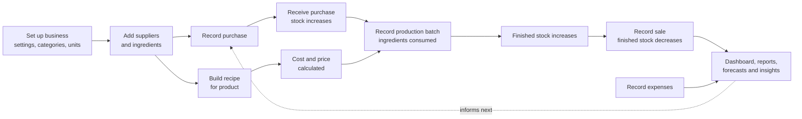
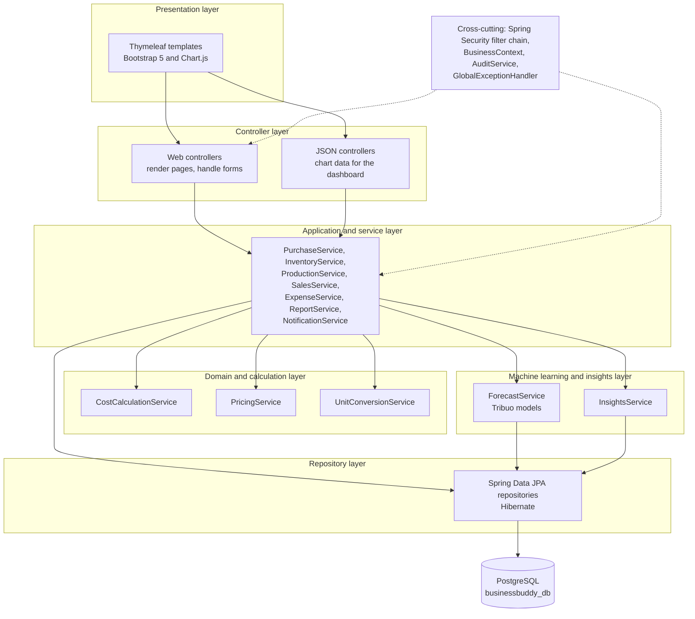
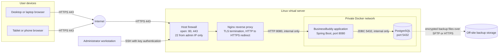
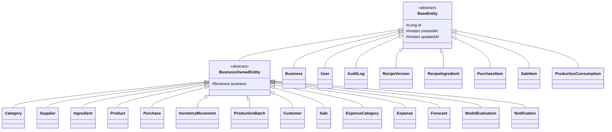
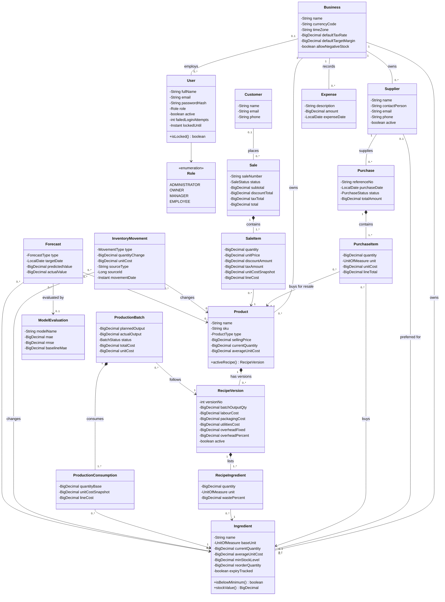
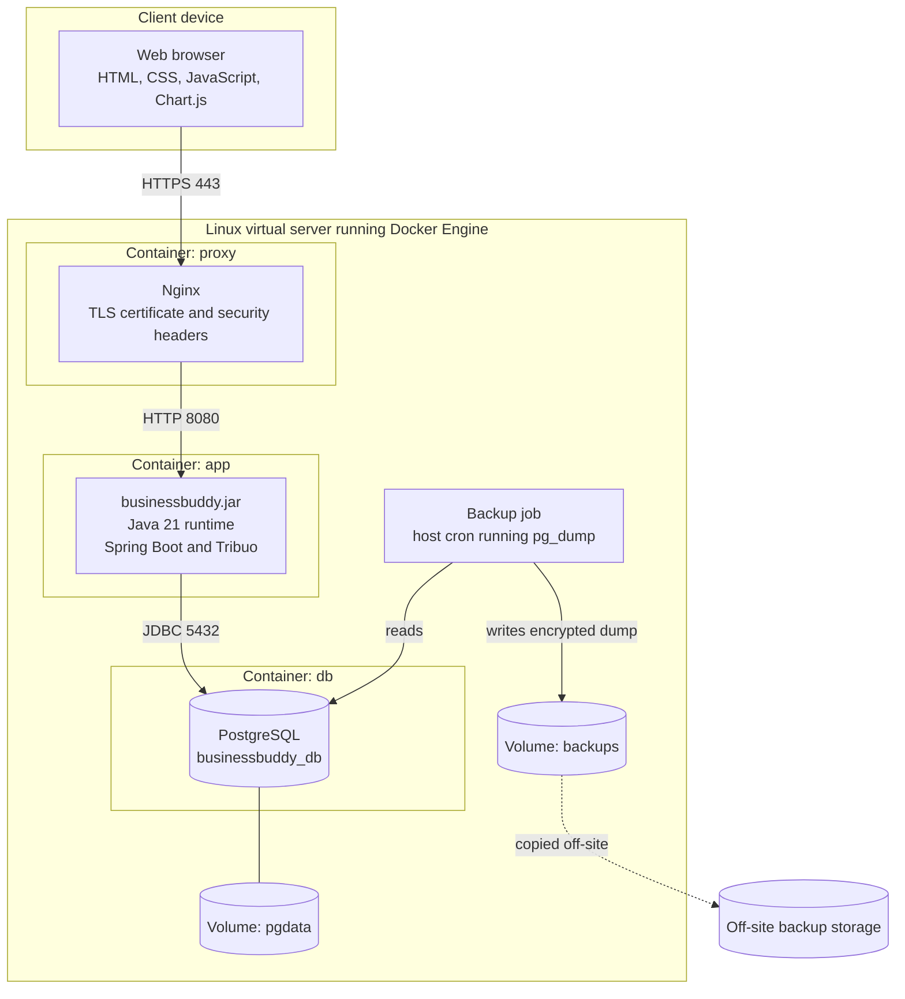

0: 688 
1: 6564 ## 4.1 Introduction

The system design phase turns the requirements identified during analysis into a detailed technical plan that developers can build and test against. Analysis answered the question of what BusinessBuddy must do. Design answers how it will do it: which software components exist, how they communicate, where data is stored, which steps each process follows, what users see, and how the system and its data are protected.

The design is the bridge between the Analysis Phase and implementation. BusinessBuddy follows an Agile life cycle, so screens and smaller features will be refined in each iteration. The decisions that are expensive to change later are fixed in this chapter: the layered architecture, the database structure, the inventory ledger, the costing rules and the security model.

The chapter is organised as follows. Section 4.2 describes the proposed system as a whole. Section 4.3 presents the software, hardware and network architecture and the class diagram. Section 4.4 describes the physical implementation and deployment. Section 4.5 presents the database design. Section 4.6 gives pseudocode for the main processes. Section 4.7 covers menus, input forms and outputs. Section 4.8 covers security and backup.

Table 4.1 lists the requirements carried into this design and where each is addressed.

**Table 4.1: Requirements carried into the design**

| ID
Requirement (from the project specification)
Addressed in |
| ---
---
--- |
| FR-01
Secure login, role-based access and business data isolation
4.3.1, 4.6.1, 4.6.2, 4.8 |
| FR-02
Business profile and settings (currency, time zone, tax, thresholds, pricing defaults)
4.5, 4.7.2 |
| FR-03
Product and ingredient categories
4.5 |
| FR-04
Ingredients and raw materials with units of measure and conversion
4.5, 4.6.3 |
| FR-05
Supplier management and purchase history
4.5, 4.7.2 |
| FR-06
Purchase recording and receipt into stock without duplicate updates
4.6.4 |
| FR-07
Inventory ledger, adjustments, waste, reconciliation and low-stock alerts
4.5, 4.6.4, 4.6.10 |
| FR-08
Products that are manufactured or bought for resale
4.5 |
| FR-09
Versioned recipes (bills of materials)
4.5, 4.6.5 |
| FR-10
Production batches that consume ingredients and add finished stock
4.6.7 |
| FR-11
Automated costing engine (CostCalculationService)
4.6.5 |
| FR-12
Pricing engine for margin, markup and tax (PricingService)
4.6.6 |
| FR-13
Sales with cost snapshots and controlled voids
4.6.8, 4.6.9 |
| FR-14
Operating expense tracking
4.5, 4.7.2 |
| FR-15
Dashboard, reports and CSV export
4.6.11, 4.7.3 |
| FR-16
Notifications that separate observed conditions from predictions
4.6.10, 4.7.3 |
| FR-17
Evaluated demand forecasting and stockout estimates
4.6.12, 4.6.13 |
| FR-18
Rule-based business insights grounded in recorded data
4.6.14 |
| NFR-01
Security: hashed passwords, CSRF protection, validation, audit logging
4.8 |
| NFR-02
Data integrity: BigDecimal money, transactions, historical snapshots
4.5, 4.6 |
| NFR-03
Usability: responsive, accessible Bootstrap interface
4.7 |
| NFR-04
Maintainability: layered design, tests, versioned migrations
4.3.1, 4.4 |
| NFR-05
Portability: Docker-based deployment
4.4 |

The specification leaves several decisions open. Table 4.2 records the choice made for this design. Each is marked for confirmation against the Analysis Phase documents, because those documents were not available while this chapter was prepared.

**Table 4.2: Design decisions and assumptions**

| No.
Decision
Reason |
| ---
---
--- |
| D1
Several businesses share one database. Every business-owned table carries a business_id, and the service layer checks it on every request.
Meets the isolation requirement without the cost of a separate database per business. |
| D2
Production batches are included in version 1. Manufactured products are held as finished stock. Made-to-order items are recorded as a production batch before or at the end of the trading day.
Ingredients are consumed when goods are made, not when they are sold, which avoids double deduction. |
| D3
Inventory is valued at weighted-average cost.
Simpler to implement and explain than FIFO, and suits ingredients that are mixed in storage. |
| D4
The inventory ledger stores a signed quantity per movement. Current stock is cached on the item and reconciled against the ledger.
Gives fast stock lookups while keeping the ledger as the source of truth. |
| D5
Prices are stored excluding tax. The tax rate is configured per business and tax is excluded from revenue.
Keeps revenue and tax separate in reports. |
| D6
Overhead is a fixed amount per batch plus an optional percentage of ingredient cost.
The percentage base is stated, as the specification requires. |
| D7
Waste is a percentage on each recipe ingredient line and is applied once only.
Prevents the waste factor being counted twice. |
| D8
Each user has exactly one role, stored on the user record.
The four roles do not overlap, so a many-to-many role table adds no value. |
| D9
Machine learning covers product demand forecasting and ingredient stockout estimates. Profit and expense forecasting are future extensions.
Focuses on one or two features that can be properly evaluated. |
| D10
The ML library is Tribuo, to be confirmed in a short prototype.
Pure Java, with built-in regression and evaluation support. |
| D11
Unless real anonymised sales data is obtained, models are trained on a demonstration dataset that is clearly labelled as such.
The specification forbids presenting fabricated data as real. |
| D12
Authentication is session-based. No JWT is used.
Server-rendered Thymeleaf pages do not need tokens. |
| D13
Deployment uses Docker Compose on one Linux virtual server behind an Nginx reverse proxy.
Simple, repeatable and inexpensive for a student project. |
| D14
Notifications are shown inside the application only.
Email and SMS are not in the specified scope. |
| D15
Money amounts are stored as NUMERIC(12,2), unit costs as NUMERIC(14,4) and quantities as NUMERIC(14,3). Rounding uses HALF_UP to 2 decimal places only when a money total is stored or displayed.
Prevents floating-point errors and makes the rounding stage explicit. |","kind":"inline"}}}]}
2: 7836 ## 4.2 System Design (Description of Proposed System)

### 4.2.1 Purpose of the system

BusinessBuddy gives small product-based businesses one place to record what they buy, what they make, what they sell and what they spend. From those records it calculates what each product really costs and what it should sell for. It also tracks how much stock is left and estimates when stock will run out or how much of a product is likely to sell. The system supports decisions; it does not replace professional accounting software.

### 4.2.2 Problems the system addresses

The specification identifies these problems with manual costing and stock control. They are treated as assumptions until confirmed by the investigation evidence gathered in earlier phases.

- Selling prices are set without counting every production cost, so the intended margin is not achieved.
- Recalculating costs by hand is slow and error-prone when ingredient prices change.
- Stock levels are unclear because purchases, production and sales are recorded in separate places.
- Historical purchase prices and product profitability are hard to trace.
- Future stock needs and demand are guessed rather than estimated from data.

### 4.2.3 Intended users

**Table 4.3: User roles**

| Role
Who they are
Main use of the system |
| ---
---
--- |
| Administrator
The system operator, not a member of any business
Manages user accounts across businesses, locks and unlocks accounts, reviews the audit log. Does not edit business transactions. |
| Business Owner
The person who registers the business
Full control of their own business: settings, users, all records, reports and forecasts. |
| Manager
A trusted staff member
Day-to-day operation: purchases, inventory, recipes, pricing, sales, expenses, reports and forecasts. Cannot change business settings or manage users. |
| Employee
Front-line staff
Records sales, production batches and waste. Views stock and products. Cannot see cost, profit or expense figures. |

### 4.2.4 Main features and functions

- **Setup:** business profile, currency, time zone, tax rate, target margin, stock thresholds, categories and units of measure.
- **Purchasing and inventory:** suppliers, purchases with line items, receipt into stock, a full movement ledger, adjustments, waste, low-stock and expiry alerts, and stock reconciliation.
- **Products and recipes:** manufactured and resale products, versioned recipes with ingredient quantities, waste percentages, labour, packaging, utilities and overhead.
- **Costing and pricing:** batch cost, unit cost, suggested selling price by margin or markup, tax, and a warning when a price is below cost.
- **Production:** batches that consume ingredients and add finished stock at a recorded cost.
- **Sales and expenses:** multi-line sales with discounts, tax and stored cost snapshots, controlled voids, and categorised operating expenses.
- **Dashboard and reports:** revenue, cost of goods sold, gross profit, operating expenses, net operating result, inventory value, trends, top products, and CSV export.
- **Forecasting and insights:** product demand forecasts compared against a baseline, ingredient stockout estimates, and plain-language insights. Every prediction is labelled as an estimate.

### 4.2.5 How the system works from the user's perspective

A business owner registers, which creates the business and its first Owner account. The owner sets the currency, tax rate and target margin, then adds categories, suppliers and ingredients. Staff record purchases; when goods arrive, a manager marks the purchase as received and stock increases. The owner builds a recipe for each manufactured product and immediately sees its batch cost, unit cost and suggested price. When a batch is made, staff record it and the ingredients are deducted. Sales are recorded at the point of sale and reduce finished stock. Each morning the dashboard shows the previous period's figures, low-stock items, forecasts and insights. Figure 4.1 shows this cycle.



*Figure 4.1: BusinessBuddy operating cycle*

### 4.2.6 Inputs, processing and outputs

**Table 4.4: Inputs, processing and outputs**

| Inputs
Processing
Outputs |
| ---
---
--- |
| Login credentials
Password check against BCrypt hash, lockout after repeated failures, session creation
Authenticated session or error message |
| Business settings
Validation and storage
Configured currency, tax, margin and thresholds |
| Ingredients, products, suppliers, categories
Validation, duplicate checks, unit conversion to base unit
Master data lists |
| Purchase and purchase lines
Totals, receipt into stock, weighted-average cost update, ledger entries
Updated stock, purchase history, price history |
| Recipe versions
Ingredient line costs, batch cost, unit cost
Recipe costing breakdown |
| Target margin or markup
Price calculation, tax, below-cost check
Suggested selling price, profit per unit, margin, markup |
| Production batch
Stock availability check, ingredient consumption, finished stock valuation
Updated ingredient and product stock, batch cost |
| Sale and sale lines
Stock check, totals, tax, cost snapshot, stock reduction
Receipt view, sales history, COGS |
| Expenses
Validation and categorisation
Expense records and trends |
| Report period and filters
Aggregation over stored historical values
Dashboard KPIs, charts, reports, CSV files |
| Historical sales and consumption
Baseline and model forecasting, chronological evaluation
Forecasts, stockout estimates, evaluation metrics, insights, notifications |

### 4.2.7 How the proposed system meets the project objectives

**Table 4.5: Objectives and design response**

| Objective (abridged)
Design response |
| ---
--- |
| 3. Normalised relational database
23-table PostgreSQL schema in Third Normal Form (4.5) |
| 4. Secure authentication and role-based authorisation
Spring Security, BCrypt, four roles, business isolation (4.6.1, 4.6.2, 4.8) |
| 5. Ingredient, supplier, purchase and inventory management
Ledger-based inventory with idempotent receipt (4.6.4) |
| 6. Products, recipes and bills of materials
Product types and versioned recipes (4.5) |
| 7. Automated costing engine
CostCalculationService (4.6.5) |
| 8. Pricing engine
PricingService (4.6.6) |
| 9. Sales, expense and profitability tracking
Sales with cost snapshots, expenses, profitability report (4.6.8, 4.6.11) |
| 10. Dashboard and reporting
Dashboard and reports with CSV export (4.7.3) |
| 11. Machine learning forecasting
Demand forecasting compared with a baseline, stockout estimates (4.6.12, 4.6.13) |
| 12. Explainable insights
Rule-based InsightsService (4.6.14) |
| 13. Testing of calculations, security and integrity
Calculation logic isolated in services so it can be unit tested; constraints enforced in the database |

Objectives 1, 2, 14 and 15 concern investigation, requirements gathering, evaluation and documentation. They are addressed in other chapters.","kind":"inline"}}}]}
3: 21176 ## 4.3 Architectural Design

### 4.3.1 Software Architectural Design

BusinessBuddy uses a **layered architecture inside a single Spring Boot application** (a modular monolith), following the Model-View-Controller pattern for the web tier. Each layer has one responsibility and may only call the layer below it. Security and auditing cut across all layers. Figure 4.2 shows the layers.



*Figure 4.2: Layered software architecture of BusinessBuddy*

**Table 4.6: Software layers**

| Layer
Package (com.businessbuddy)
Responsibility |
| ---
---
--- |
| Presentation
src/main/resources/templates, static
Thymeleaf pages, Bootstrap layout, Chart.js charts. No business logic. |
| Controller
controller, dto
Receives HTTP requests, validates DTOs with Jakarta Bean Validation, calls one service method, returns a view or JSON. Kept thin. |
| Application and service
service, service.inventory, service.reporting
Business workflows and transaction boundaries (@Transactional). Applies business isolation and role rules. |
| Domain and calculation
service.costing, service.pricing
Pure calculation classes using BigDecimal. No database access, so they can be unit tested in isolation. |
| Machine learning and insights
ml, service.insights
Prepares time series, trains and evaluates models, stores forecasts, produces rule-based insights. |
| Repository
repository, entity
JPA entities and Spring Data repositories. All queries are parameterised. |
| Database
Flyway migrations in db/migration
PostgreSQL schema, constraints and indexes. |
| Cross-cutting
security, audit, exception, validation, config
Authentication, authorisation, current-business resolution, audit logging, error handling. |

**How the components communicate**

1. The browser sends an HTTPS request. The Spring Security filter chain checks the session, CSRF token and role before any controller runs.
2. The controller converts form data into a DTO and validates it. Invalid input returns the form with field errors.
3. The controller calls a service method. The service resolves the current business from BusinessContext, loads entities through repositories, and rejects any record that belongs to another business.
4. Calculation services (costing, pricing, unit conversion) are called as plain Java methods and return immutable result objects.
5. Write operations run inside one database transaction, so a stock movement and the document that caused it are saved together or not at all.
6. The controller returns a Thymeleaf view. Dashboard charts call JSON endpoints in the same session to fetch their data.
7. Two scheduled jobs (Spring @Scheduled) run nightly: one refreshes forecasts and insights, the other checks stock levels and expiry dates and raises notifications.

**Why this architecture suits BusinessBuddy**

- Purchases, production, sales and inventory must update together in single transactions. One application with one database makes this straightforward. Separate microservices would need distributed transactions.
- A small team can build, test and deploy one artifact (businessbuddy.jar) within the project timeline.
- Thin controllers and isolated calculation classes let the costing, pricing and inventory rules be unit tested without a web server or database.
- Clear package boundaries mean a module such as forecasting could later be moved into its own service if this were ever justified.
- Server-rendered Thymeleaf pages work with session authentication and built-in CSRF protection, which reduces security risk.

### 4.3.2 Hardware Architectural Design

BusinessBuddy is a web application, so end users need only a device with a modern browser. All processing and storage take place on one server. The figures below are proposed minimums for a single small deployment, sized for the expected load of a few businesses with a handful of users each. They should be revisited if performance testing shows otherwise.

**Table 4.7: Hardware requirements**

| Environment
Component
Minimum
Recommended
Why it is needed |
| ---
---
---
---
--- |
| Development workstation
CPU
4 cores, 64-bit
6 or more cores
Running the IDE, Maven builds, Docker and test containers together |
| Development workstation
Memory
8 GB
16 GB
Java IDE, application, PostgreSQL container and Testcontainers |
| Development workstation
Storage
20 GB free SSD
50 GB free SSD
JDK, Maven repository, Docker images, project files |
| Production server
CPU
2 vCPU
4 vCPU
Handling requests and nightly model training |
| Production server
Memory
4 GB
8 GB
About 1 GB for the JVM, 1 GB for PostgreSQL, the remainder for the OS and training |
| Production server
Storage
40 GB SSD
80 GB SSD
Operating system, database, logs and local backup copies |
| Production server
Network
Public IPv4, 100 Mbps
Same
Serving HTTPS traffic |
| Backup storage
Off-site object or SFTP storage
50 GB
100 GB
Retaining encrypted backups away from the server |
| Client device
Desktop, laptop, tablet or phone
Current Chrome, Edge, Firefox or Safari; screen width from 360 px
1280 x 720 or larger for reports
Accessing the responsive interface |
| Client peripherals
Printer (optional)
Any
Any
Printing reports and receipts from the browser |

The server hardware supports the system by keeping the application and database on fast SSD storage, which matters most for report queries over sales history. Memory is sized so that model training at night does not slow down daytime users. Because clients only run a browser, businesses can use the devices they already own.

### 4.3.3 Network Architectural Design

Users reach BusinessBuddy over the internet using HTTPS. Only the reverse proxy is exposed publicly. The application and the database sit on a private Docker network that cannot be reached from outside the server. Figure 4.3 shows the network.



*Figure 4.3: Network architecture of BusinessBuddy*

**Table 4.8: Network connections**

| From
To
Protocol and port
Security measure |
| ---
---
---
--- |
| User browser
Nginx
HTTPS, TCP 443
TLS 1.2 or higher, HSTS header, secure session cookie |
| User browser
Nginx
HTTP, TCP 80
Immediate redirect to HTTPS; no data served |
| Nginx
Application
HTTP, TCP 8080
Private Docker network only; port not published to the host |
| Application
PostgreSQL
JDBC over TCP 5432
Private Docker network only; dedicated database user with least privilege |
| Backup job
Off-site storage
SFTP or HTTPS
Files encrypted before transfer |
| Administrator
Server
SSH, TCP 22
Key-based login only, restricted to the administrator's IP address |

**How data travels securely**

A user opens the BusinessBuddy address in a browser. Nginx presents a TLS certificate (for example from Let's Encrypt) and decrypts the request. It then forwards the request to the application over the private network. The application reads and writes the database over the same private network and returns the page through Nginx, which encrypts the response. Passwords and session cookies therefore never cross the internet in plain text. The database has no public port, so it can only be reached through the application. Backups leave the server only after encryption.

### 4.3.4 Class Diagram

The class model is shown in three figures so each remains readable when pasted into Word. Figure 4.4 shows inheritance among entities. Figure 4.5 shows the main entities with their attributes, methods and multiplicities. Figure 4.6 shows the service and machine learning classes that operate on them.



*Figure 4.4: Entity inheritance hierarchy*



*Figure 4.5: Main domain classes, attributes and multiplicities*

```mermaid
classDiagram
    class CostCalculationService {
        -UnitConversionService units
        +lineCost(RecipeIngredient line) BigDecimal
        +batchCost(RecipeVersion recipe) CostBreakdown
    }
    class CostBreakdown {
        <<record>>
        +BigDecimal ingredientCost
        +BigDecimal overheadCost
        +BigDecimal batchCost
        +BigDecimal unitCost
    }
    class PricingService {
        +priceForMargin(BigDecimal unitCost, BigDecimal margin) BigDecimal
        +priceForMarkup(BigDecimal unitCost, BigDecimal markup) BigDecimal
        +analyse(BigDecimal unitCost, BigDecimal price, BigDecimal taxRate) PriceAnalysis
    }
    class PriceAnalysis {
        <<record>>
        +BigDecimal profitPerUnit
        +BigDecimal marginPercent
        +BigDecimal markupPercent
        +BigDecimal priceIncludingTax
        +boolean belowCost
    }
    class UnitConversionService {
        +toBase(BigDecimal qty, UnitOfMeasure from, UnitOfMeasure base) BigDecimal
    }
    class InventoryService {
        +recordMovement(MovementRequest request) InventoryMovement
        +receivePurchase(Long purchaseId) Purchase
        +reconcile(Long itemId) ReconciliationResult
    }
    class ProductionService {
        +confirmBatch(Long batchId) ProductionBatch
    }
    class SalesService {
        +confirmSale(Long saleId) Sale
        +voidSale(Long saleId, String reason) Sale
    }
    class ReportService {
        +profitability(DateRange range) ProfitabilityReport
        +exportCsv(ReportType type, DateRange range) ExportFile
    }
    class ForecastModel {
        <<interface>>
        +train(List~DemandPoint~ history) void
        +predict(LocalDate date) BigDecimal
        +name() String
    }
    class MovingAverageForecaster {
        -int windowDays
    }
    class RegressionForecaster {
        -Model tribuoModel
    }
    class ForecastService {
        +runDemandForecast(Long productId) ForecastResult
        +estimateStockout(Long ingredientId) StockoutEstimate
    }
    class InsightsService {
        +generate(DateRange range) List~Insight~
    }
    class NotificationService {
        +raise(NotificationRequest request) void
    }
    class BusinessContext {
        +currentBusinessId() Long
        +requireSameBusiness(BusinessOwnedEntity entity) void
    }
    class AuditService {
        +record(String action, String entityType, Long entityId) void
    }
    ForecastModel <|.. MovingAverageForecaster
    ForecastModel <|.. RegressionForecaster
    ForecastService --> ForecastModel : compares
    CostCalculationService --> UnitConversionService
    CostCalculationService ..> CostBreakdown : creates
    PricingService ..> PriceAnalysis : creates
    ProductionService --> CostCalculationService
    ProductionService --> InventoryService
    SalesService --> InventoryService
    SalesService --> PricingService
    InventoryService --> NotificationService
    InventoryService --> AuditService
    InsightsService --> ReportService
    InsightsService --> ForecastService
    ReportService --> BusinessContext
    InventoryService --> BusinessContext
```



*Figure 4.6: Service, calculation and machine learning classes*

**Explanation of the class diagrams**

- **Inheritance (Figure 4.4).** Every entity inherits an identifier and timestamps from the abstract BaseEntity. Entities that belong directly to one business inherit from BusinessOwnedEntity, which holds the business reference. This lets BusinessContext check ownership in one place. Child records such as PurchaseItem and SaleItem reach their business through their parent document, so they extend BaseEntity directly. User extends BaseEntity because the Administrator role has no business.
- **Composition (filled diamonds in Figure 4.5).** A purchase, sale, recipe version or production batch owns its lines. The lines cannot exist without the parent, and at least one line is required.
- **Optional references.** A purchase line or inventory movement refers to either an ingredient or a product, never both, so each reference has multiplicity 0..1. A forecast refers to a product for demand forecasts or to an ingredient for stockout estimates.
- **Snapshots.** SaleItem.unitCostSnapshot and ProductionConsumption.unitCostSnapshot hold the cost at the moment of confirmation, so later price changes do not alter historical profit.
- **Strategy pattern (Figure 4.6).** ForecastService works through the ForecastModel interface. The moving-average baseline and the trained regression model are interchangeable, which allows the system to compare them on the same test period.
- **Calculation classes.** CostCalculationService and PricingService return immutable records (CostBreakdown, PriceAnalysis). They contain no database code, so they can be tested directly with JUnit.","kind":"inline"}}}]}
4: 8471 ## 4.4 Physical Design

Physically, BusinessBuddy is one Java application packaged as businessbuddy.jar, one PostgreSQL database named businessbuddy_db, and one Nginx reverse proxy. Each runs in its own Docker container on a single Linux server. This section explains what each physical component is, how the code is organised, and where each part runs.

### 4.4.1 Physical components

**Table 4.9: Physical components**

| Component
Technology
Location
Purpose |
| ---
---
---
--- |
| Web client
Browser running HTML5, CSS3, Bootstrap 5, JavaScript, Chart.js
User device
Displays pages and charts, performs light client-side checks |
| Reverse proxy
Nginx
Container proxy
TLS termination, HTTP to HTTPS redirect, security headers, request size limits |
| Application
Java 21, Spring Boot 3, Spring Security, Spring Data JPA, Hibernate, Thymeleaf, Tribuo
Container app
All business logic, calculations, forecasting and page rendering |
| Database
PostgreSQL
Container db, data on volume pgdata
Persistent storage of all business records |
| Schema migrations
Flyway
Runs inside the application at start-up
Applies versioned schema changes in order |
| Scheduled jobs
Spring @Scheduled
Inside the application
Nightly forecasts, insights, stock and expiry checks |
| Backup job
Host cron with pg_dump and an encryption tool
Server host, volume backups
Daily database backups and off-site copy |
| Source control and CI
Git, GitHub, GitHub Actions
Cloud
Version history, automated build and tests |

### 4.4.2 Software modules and code organisation

The application is a single Maven project (groupId com.businessbuddy, artifactId businessbuddy). Code is grouped by technical layer, with feature sub-packages inside the service layer.

```text
businessbuddy/
├── pom.xml
├── Dockerfile
├── docker-compose.yml
├── .env.example                      variable names only, no real secrets
├── src/main/java/com/businessbuddy/
│   ├── BusinessBuddyApplication.java
│   ├── config/                       security, scheduling, web configuration
│   ├── controller/                   one controller per module
│   ├── dto/                          form and response objects with validation
│   ├── entity/                       JPA entities and enums
│   ├── repository/                   Spring Data JPA interfaces
│   ├── service/                      purchase, production, sales, expense services
│   │   ├── costing/                  CostCalculationService, UnitConversionService
│   │   ├── inventory/                InventoryService, reconciliation
│   │   ├── pricing/                  PricingService
│   │   ├── reporting/                ReportService, CSV export
│   │   └── insights/                 InsightsService and insight rules
│   ├── ml/                           ForecastModel, forecasters, evaluation
│   ├── security/                     user details, BusinessContext, lockout
│   ├── validation/                   custom validators
│   ├── exception/                    GlobalExceptionHandler, custom exceptions
│   ├── audit/                        AuditService
│   └── util/                         money and date helpers
├── src/main/resources/
│   ├── application.yml               shared settings
│   ├── application-dev.yml           local development
│   ├── application-prod.yml          production, secrets from environment
│   ├── db/migration/                 Flyway scripts V1__..., V2__...
│   ├── templates/                    Thymeleaf pages grouped by module
│   └── static/                       css, js, images
└── src/test/java/com/businessbuddy/  unit, integration and security tests
```

*Figure 4.7: Project structure*

**Table 4.10: Functional modules and their main classes**

| Module
Controller
Main service classes
Main tables |
| ---
---
---
--- |
| Authentication and users
AuthController, UserController
UserService, LoginAttemptService
app_user, audit_log |
| Business settings
BusinessController
BusinessService
business |
| Categories and units
CategoryController
CategoryService
category, unit_of_measure |
| Suppliers
SupplierController
SupplierService
supplier |
| Ingredients and inventory
IngredientController, InventoryController
InventoryService
ingredient, inventory_movement |
| Purchases
PurchaseController
PurchaseService, InventoryService
purchase, purchase_item |
| Products and recipes
ProductController, RecipeController
ProductService, CostCalculationService
product, recipe_version, recipe_ingredient |
| Pricing
PricingController
PricingService
product, business |
| Production
ProductionController
ProductionService
production_batch, production_consumption |
| Sales and customers
SaleController, CustomerController
SalesService
sale, sale_item, customer |
| Expenses
ExpenseController
ExpenseService
expense, expense_category |
| Dashboard and reports
DashboardController, ReportController
ReportService
read-only queries across tables |
| Forecasts and insights
ForecastController, InsightController
ForecastService, InsightsService
forecast, model_evaluation |
| Notifications
NotificationController
NotificationService
notification |

### 4.4.3 Deployment environment and component placement

Three environments are used. The development environment runs on each developer's workstation, with PostgreSQL in Docker. The test environment runs in GitHub Actions, using Testcontainers to start a real PostgreSQL database for integration tests. The production environment runs on the Linux server, as shown in Figure 4.8.



*Figure 4.8: Deployment diagram*

The application and database are on the same host because the expected load is small, and placing them together keeps the database off the public network. Configuration that differs between environments (database URL, user name, password) is supplied through environment variables listed in .env.example, never committed to Git. The database data lives on a named Docker volume, so containers can be replaced during upgrades without losing data.

### 4.4.4 Performance, reliability and maintainability

**Performance**

- Current stock and average cost are cached on each ingredient and product, so stock screens do not sum the whole ledger.
- Indexes are placed on business_id and the date columns used by reports (4.5.6).
- List screens use server-side pagination.
- Model training runs at night, outside trading hours.

**Reliability**

- Every stock-changing operation runs in one transaction. A failure rolls back both the document and its stock movements.
- Database constraints (foreign keys, CHECK rules, unique keys) stop invalid data even if application code has a defect.
- Docker restart policies bring containers back after a crash or reboot.
- A reconciliation routine compares cached stock against the ledger and reports any difference.

**Maintainability**

- The layer and package structure means each change has an obvious home.
- Flyway migrations version every schema change.
- Automated tests in GitHub Actions run on every push, so a change that breaks a calculation is caught before release.
- Rebuilding the app container with a new businessbuddy.jar updates the system without touching the database.","kind":"inline"}}}]}
5: 33198 ## 4.5 Database Design

### 4.5.1 Database structure

BusinessBuddy stores its data in one PostgreSQL database, businessbuddy_db, with 23 tables. The design follows four rules taken from the specification.

1. **Business isolation.** Every table that holds a business's own data has a business_id column, either directly or through its parent document.
2. **Ledger-based inventory.** Each stock change is one row in inventory_movement. The current_quantity on ingredient and product is a cached total of that ledger.
3. **Historical snapshots.** Purchase lines, sale lines and production consumption store the price, cost and quantity at the moment of confirmation. Later price or recipe changes never rewrite history.
4. **No hard deletes of financial records.** Confirmed purchases, sales and batches are cancelled or voided through status changes and reversing movements.

The following conventions apply to every table.

- Primary keys are BIGINT identity columns named <table>_id. The exception is unit_of_measure, which uses its unit code.
- Every table except unit_of_measure has created_at and updated_at columns (TIMESTAMPTZ NOT NULL). These are inherited from BaseEntity and are not repeated in the data dictionary below.
- Money amounts that are charged or paid are NUMERIC(12,2). Unit costs and cost lines are NUMERIC(14,4). Quantities are NUMERIC(14,3). Rates and percentages are NUMERIC(5,4) stored as decimals, so 15% is 0.1500.
- Status and type columns are VARCHAR with a CHECK constraint listing the allowed values. These map to Java enums.
- The table for users is named app_user because user is a reserved word in PostgreSQL.

### 4.5.2 Tables required

**Table 4.11: Database tables**

| Group
Table
Purpose |
| ---
---
--- |
| Security
business
A registered business and its settings |
| Security
app_user
A login account with one role |
| Security
audit_log
An append-only record of important actions |
| Reference
unit_of_measure
Units and their conversion factor to the base unit |
| Reference
category
Product and ingredient categories |
| Purchasing
supplier
Suppliers of a business |
| Purchasing
purchase
A purchase document (header) |
| Purchasing
purchase_item
One line of a purchase |
| Inventory
ingredient
An ingredient or raw material, with cached stock and average cost |
| Inventory
inventory_movement
The stock ledger: one row per stock change |
| Products
product
A manufactured or resale product, with cached stock and average cost |
| Products
recipe_version
One version of a product's recipe, including batch output and overheads |
| Products
recipe_ingredient
One ingredient line within a recipe version |
| Production
production_batch
A production run of a product |
| Production
production_consumption
The actual ingredients consumed by a batch, with cost snapshots |
| Sales
customer
An optional customer record |
| Sales
sale
A sale document (header) |
| Sales
sale_item
One line of a sale, with price and cost snapshots |
| Expenses
expense_category
Expense categories (rent, electricity and so on) |
| Expenses
expense
An operating expense |
| Forecasting
forecast
A stored demand forecast or stockout estimate |
| Forecasting
model_evaluation
The evaluation results of a model against its baseline |
| Alerts
notification
An in-app alert, either observed or predicted |

Three entities listed as options in the specification are deliberately not separate tables. **Role and UserRole** are replaced by a role column, because each user has exactly one role (D8). **Recipe** is merged into recipe_version, because a product has a single recipe that changes only by version. **SupplierIngredient** is not needed, because the preferred supplier is a column on ingredient and price history is already held in purchase_item. Business insights are generated on request from stored data, so they need no table.

### 4.5.3 Entity Relationship Diagram

Figure 4.9 shows all tables and relationships. Only key columns and a few identifying columns are shown; the full attribute list is in 4.5.4.

```mermaid
erDiagram
    BUSINESS ||--o{ APP_USER : employs
    BUSINESS |o--o{ AUDIT_LOG : scopes
    APP_USER |o--o{ AUDIT_LOG : performs
    BUSINESS ||--o{ CATEGORY : defines
    BUSINESS ||--o{ SUPPLIER : uses
    BUSINESS ||--o{ INGREDIENT : stocks
    BUSINESS ||--o{ PRODUCT : sells
    BUSINESS ||--o{ PURCHASE : places
    BUSINESS ||--o{ PRODUCTION_BATCH : runs
    BUSINESS ||--o{ CUSTOMER : serves
    BUSINESS ||--o{ SALE : records
    BUSINESS ||--o{ EXPENSE_CATEGORY : defines
    BUSINESS ||--o{ EXPENSE : incurs
    BUSINESS ||--o{ INVENTORY_MOVEMENT : logs
    BUSINESS ||--o{ FORECAST : receives
    BUSINESS ||--o{ MODEL_EVALUATION : holds
    BUSINESS ||--o{ NOTIFICATION : receives
    CATEGORY |o--o{ INGREDIENT : groups
    CATEGORY |o--o{ PRODUCT : groups
    UNIT_OF_MEASURE ||--o{ INGREDIENT : "base unit"
    UNIT_OF_MEASURE ||--o{ PRODUCT : "sale unit"
    SUPPLIER |o--o{ INGREDIENT : "preferred for"
    SUPPLIER ||--o{ PURCHASE : supplies
    SUPPLIER |o--o{ EXPENSE : "paid to"
    PURCHASE ||--|{ PURCHASE_ITEM : contains
    INGREDIENT |o--o{ PURCHASE_ITEM : "bought as"
    PRODUCT |o--o{ PURCHASE_ITEM : "bought for resale"
    PRODUCT ||--o{ RECIPE_VERSION : has
    RECIPE_VERSION ||--|{ RECIPE_INGREDIENT : lists
    INGREDIENT ||--o{ RECIPE_INGREDIENT : "used in"
    PRODUCT ||--o{ PRODUCTION_BATCH : "made in"
    RECIPE_VERSION ||--o{ PRODUCTION_BATCH : "followed by"
    PRODUCTION_BATCH ||--|{ PRODUCTION_CONSUMPTION : consumes
    INGREDIENT ||--o{ PRODUCTION_CONSUMPTION : "consumed as"
    CUSTOMER |o--o{ SALE : places
    SALE ||--|{ SALE_ITEM : contains
    PRODUCT ||--o{ SALE_ITEM : "sold as"
    EXPENSE_CATEGORY ||--o{ EXPENSE : classifies
    INGREDIENT |o--o{ INVENTORY_MOVEMENT : moves
    PRODUCT |o--o{ INVENTORY_MOVEMENT : moves
    APP_USER ||--o{ INVENTORY_MOVEMENT : initiates
    APP_USER ||--o{ SALE : records
    APP_USER ||--o{ PURCHASE : creates
    PRODUCT |o--o{ FORECAST : "demand for"
    INGREDIENT |o--o{ FORECAST : "stockout for"
    MODEL_EVALUATION |o--o{ FORECAST : evaluates
    PRODUCT |o--o{ MODEL_EVALUATION : "evaluated for"

    BUSINESS {
        bigint business_id PK
        varchar name
        char currency_code
    }
    APP_USER {
        bigint user_id PK
        bigint business_id FK
        varchar email UK
        varchar role
    }
    AUDIT_LOG {
        bigint audit_id PK
        bigint business_id FK
        bigint user_id FK
        varchar action
    }
    UNIT_OF_MEASURE {
        varchar unit_code PK
        varchar dimension
        numeric factor_to_base
    }
    CATEGORY {
        bigint category_id PK
        bigint business_id FK
        varchar name
    }
    SUPPLIER {
        bigint supplier_id PK
        bigint business_id FK
        varchar name
    }
    INGREDIENT {
        bigint ingredient_id PK
        bigint business_id FK
        bigint category_id FK
        bigint preferred_supplier_id FK
        varchar base_unit_code FK
        numeric current_quantity
        numeric average_unit_cost
    }
    PRODUCT {
        bigint product_id PK
        bigint business_id FK
        bigint category_id FK
        varchar sale_unit_code FK
        varchar product_type
        numeric selling_price
    }
    RECIPE_VERSION {
        bigint recipe_version_id PK
        bigint product_id FK
        int version_no
        numeric batch_output_qty
    }
    RECIPE_INGREDIENT {
        bigint recipe_ingredient_id PK
        bigint recipe_version_id FK
        bigint ingredient_id FK
        numeric quantity
    }
    PURCHASE {
        bigint purchase_id PK
        bigint business_id FK
        bigint supplier_id FK
        varchar status
    }
    PURCHASE_ITEM {
        bigint purchase_item_id PK
        bigint purchase_id FK
        bigint ingredient_id FK
        bigint product_id FK
        numeric unit_cost
    }
    PRODUCTION_BATCH {
        bigint batch_id PK
        bigint business_id FK
        bigint product_id FK
        bigint recipe_version_id FK
        varchar status
    }
    PRODUCTION_CONSUMPTION {
        bigint consumption_id PK
        bigint batch_id FK
        bigint ingredient_id FK
        numeric unit_cost_snapshot
    }
    CUSTOMER {
        bigint customer_id PK
        bigint business_id FK
        varchar name
    }
    SALE {
        bigint sale_id PK
        bigint business_id FK
        bigint customer_id FK
        varchar status
        numeric total
    }
    SALE_ITEM {
        bigint sale_item_id PK
        bigint sale_id FK
        bigint product_id FK
        numeric unit_price
        numeric unit_cost_snapshot
    }
    EXPENSE_CATEGORY {
        bigint expense_category_id PK
        bigint business_id FK
        varchar name
    }
    EXPENSE {
        bigint expense_id PK
        bigint business_id FK
        bigint expense_category_id FK
        bigint supplier_id FK
        numeric amount
    }
    INVENTORY_MOVEMENT {
        bigint movement_id PK
        bigint business_id FK
        bigint ingredient_id FK
        bigint product_id FK
        varchar movement_type
        numeric quantity_change
    }
    FORECAST {
        bigint forecast_id PK
        bigint business_id FK
        bigint product_id FK
        bigint ingredient_id FK
        bigint model_evaluation_id FK
        numeric predicted_value
    }
    MODEL_EVALUATION {
        bigint evaluation_id PK
        bigint business_id FK
        bigint product_id FK
        numeric mae
        numeric baseline_mae
    }
    NOTIFICATION {
        bigint notification_id PK
        bigint business_id FK
        varchar notification_type
        varchar nature
    }
```



*Figure 4.9: Entity Relationship Diagram of businessbuddy_db*

**Reading the main relationships**

- A business has many users, ingredients, products, suppliers, purchases, sales and expenses. Each of these belongs to exactly one business. An Administrator account has no business, so the relationship is optional on the user side.
- A purchase has one or more purchase items. Each item refers to exactly one ingredient or one resale product, so both references are optional and a CHECK rule requires exactly one.
- A product has zero or more recipe versions. Each version has one or more recipe ingredients. The ingredient-to-recipe relationship is many-to-many, resolved by recipe_ingredient.
- A production batch follows one recipe version and has one or more consumption lines.
- A sale has one or more sale items. A customer is optional.
- An inventory movement changes exactly one ingredient or one product.
- A forecast concerns a product (demand) or an ingredient (stockout). It may link to the evaluation that justified the chosen model.

### 4.5.4 Data dictionary

PK = primary key, FK = foreign key, NN = NOT NULL, UQ = unique. created_at and updated_at are omitted as explained in 4.5.1.

**Table 4.12: business**

| Column
Data type
Constraints
Description |
| ---
---
---
--- |
| business_id
BIGINT
PK, identity
Business identifier |
| name
VARCHAR(150)
NN
Business name |
| email
VARCHAR(255)
| Contact email |
| phone
VARCHAR(30)
| Contact telephone |
| address
VARCHAR(300)
| Physical address |
| currency_code
CHAR(3)
NN
ISO 4217 currency code chosen at registration |
| time_zone
VARCHAR(64)
NN
IANA time zone, for example Africa/Johannesburg |
| default_tax_rate
NUMERIC(5,4)
NN, default 0, 0 to below 1
Tax rate applied to new sale lines |
| default_target_margin
NUMERIC(5,4)
NN, default 0, 0 to below 1
Target gross margin used by the pricing engine and insights |
| allow_negative_stock
BOOLEAN
NN, default false
If true, stock may go below zero; every such movement is audited |

**Table 4.13: app_user**

| Column
Data type
Constraints
Description |
| ---
---
---
--- |
| user_id
BIGINT
PK
User identifier |
| business_id
BIGINT
FK business
Null only for the Administrator role |
| full_name
VARCHAR(120)
NN
Display name |
| email
VARCHAR(255)
NN, UQ, stored in lower case
Login name |
| password_hash
VARCHAR(100)
NN
BCrypt hash; the password itself is never stored |
| role
VARCHAR(20)
NN, ADMINISTRATOR / OWNER / MANAGER / EMPLOYEE
The user's single role |
| is_active
BOOLEAN
NN, default true
Deactivated users cannot log in |
| failed_login_attempts
INTEGER
NN, default 0, 0 or more
Consecutive failed logins |
| locked_until
TIMESTAMPTZ
| Temporary lockout end time |
| last_login_at
TIMESTAMPTZ
| Last successful login |

A CHECK rule requires business_id to be null for ADMINISTRATOR and not null for every other role.

**Table 4.14: audit_log**

| Column
Data type
Constraints
Description |
| ---
---
---
--- |
| audit_id
BIGINT
PK
Entry identifier |
| business_id
BIGINT
FK business
Business concerned, if any |
| user_id
BIGINT
FK app_user
Who acted; null for system jobs and failed logins with an unknown email |
| action
VARCHAR(40)
NN
For example LOGIN_SUCCESS, SALE_VOIDED, STOCK_ADJUSTED |
| entity_type
VARCHAR(40)
| Affected table or entity |
| entity_id
BIGINT
| Affected record |
| details
JSONB
| Old and new values where relevant; never passwords |
| ip_address
VARCHAR(45)
| Client address (IPv4 or IPv6) |

**Table 4.15: unit_of_measure**

| Column
Data type
Constraints
Description |
| ---
---
---
--- |
| unit_code
VARCHAR(10)
PK
g, kg, ml, l, unit, dozen, m |
| name
VARCHAR(40)
NN
Gram, Kilogram and so on |
| dimension
VARCHAR(10)
NN, MASS / VOLUME / COUNT / LENGTH
Only units of the same dimension can be converted |
| factor_to_base
NUMERIC(18,6)
NN, above 0
Multiplier to the base unit of the dimension (kg = 1000 g) |

**Table 4.16: category**

| Column
Data type
Constraints
Description |
| ---
---
---
--- |
| category_id
BIGINT
PK
Category identifier |
| business_id
BIGINT
FK business, NN
Owning business |
| name
VARCHAR(80)
NN
Category name |
| category_type
VARCHAR(12)
NN, PRODUCT / INGREDIENT
What the category groups |

UQ (business_id, category_type, name).

**Table 4.17: supplier**

| Column
Data type
Constraints
Description |
| ---
---
---
--- |
| supplier_id
BIGINT
PK
Supplier identifier |
| business_id
BIGINT
FK business, NN
Owning business |
| name
VARCHAR(150)
NN
Supplier name |
| contact_person
VARCHAR(120)
| Main contact |
| email
VARCHAR(255)
| Contact email |
| phone
VARCHAR(30)
| Contact telephone |
| address
VARCHAR(300)
| Address |
| notes
TEXT
| Free notes |
| is_active
BOOLEAN
NN, default true
Inactive suppliers are hidden from new purchases |

UQ (business_id, name).

**Table 4.18: ingredient**

| Column
Data type
Constraints
Description |
| ---
---
---
--- |
| ingredient_id
BIGINT
PK
Ingredient identifier |
| business_id
BIGINT
FK business, NN
Owning business |
| category_id
BIGINT
FK category
Optional category |
| preferred_supplier_id
BIGINT
FK supplier
Optional preferred supplier |
| name
VARCHAR(120)
NN
Ingredient or material name |
| description
VARCHAR(500)
| Description |
| base_unit_code
VARCHAR(10)
FK unit_of_measure, NN
Unit in which stock is held, for example g |
| current_quantity
NUMERIC(14,3)
NN, default 0
Cached sum of the ledger, in the base unit |
| average_unit_cost
NUMERIC(14,4)
NN, default 0, 0 or more
Weighted-average cost per base unit |
| min_stock_level
NUMERIC(14,3)
NN, default 0, 0 or more
Low-stock threshold |
| reorder_quantity
NUMERIC(14,3)
above 0
Suggested reorder amount |
| expiry_tracked
BOOLEAN
NN, default false
If true, purchase lines must record an expiry date |
| is_active
BOOLEAN
NN, default true
Inactive items are hidden but kept for history |

UQ (business_id, name).

**Table 4.19: product**

| Column
Data type
Constraints
Description |
| ---
---
---
--- |
| product_id
BIGINT
PK
Product identifier |
| business_id
BIGINT
FK business, NN
Owning business |
| category_id
BIGINT
FK category
Optional category |
| name
VARCHAR(120)
NN
Product name |
| sku
VARCHAR(40)
| Stock-keeping unit code |
| description
VARCHAR(500)
| Description |
| product_type
VARCHAR(12)
NN, MANUFACTURED / RESALE
Made from a recipe, or bought and resold |
| sale_unit_code
VARCHAR(10)
FK unit_of_measure, NN
Unit of sale, usually unit |
| selling_price
NUMERIC(12,2)
NN, 0 or more
Current list price, excluding tax |
| current_quantity
NUMERIC(14,3)
NN, default 0
Cached finished stock |
| average_unit_cost
NUMERIC(14,4)
NN, default 0, 0 or more
Weighted-average cost per unit of finished stock |
| min_stock_level
NUMERIC(14,3)
NN, default 0, 0 or more
Low-stock threshold |
| is_active
BOOLEAN
NN, default true
Inactive products cannot be sold |

UQ (business_id, name) and UQ (business_id, sku).

**Table 4.20: recipe_version**

| Column
Data type
Constraints
Description |
| ---
---
---
--- |
| recipe_version_id
BIGINT
PK
Recipe version identifier |
| product_id
BIGINT
FK product, NN
Product made by this recipe |
| version_no
INTEGER
NN, above 0
Version number |
| name
VARCHAR(120)
NN
Recipe name |
| batch_output_qty
NUMERIC(14,3)
NN, above 0
Expected output of one batch |
| output_unit_code
VARCHAR(10)
FK unit_of_measure, NN
Unit of the output |
| labour_cost
NUMERIC(12,2)
NN, default 0, 0 or more
Direct labour per batch |
| packaging_cost
NUMERIC(12,2)
NN, default 0, 0 or more
Packaging per batch |
| utilities_cost
NUMERIC(12,2)
NN, default 0, 0 or more
Allocated utilities per batch |
| overhead_fixed
NUMERIC(12,2)
NN, default 0, 0 or more
Fixed overhead per batch |
| overhead_percent
NUMERIC(5,4)
NN, default 0, 0 to 1
Overhead as a share of ingredient cost |
| preparation_notes
TEXT
| Method notes |
| is_active
BOOLEAN
NN, default false
Only one active version per product |
| effective_from
DATE
NN
Date the version applies from |
| created_by
BIGINT
FK app_user, NN
Author |

UQ (product_id, version_no). A partial unique index allows only one active version per product. A version used by a confirmed production batch cannot be edited; changes create a new version.

**Table 4.21: recipe_ingredient**

| Column
Data type
Constraints
Description |
| ---
---
---
--- |
| recipe_ingredient_id
BIGINT
PK
Line identifier |
| recipe_version_id
BIGINT
FK recipe_version, NN
Parent recipe version |
| ingredient_id
BIGINT
FK ingredient, NN
Ingredient used |
| quantity
NUMERIC(14,3)
NN, above 0
Quantity per batch |
| unit_code
VARCHAR(10)
FK unit_of_measure, NN
Unit of the quantity; must share the ingredient's dimension |
| waste_percent
NUMERIC(5,4)
NN, default 0, 0 to below 1
Expected loss on this line |
| notes
VARCHAR(300)
| Notes |

UQ (recipe_version_id, ingredient_id).

**Table 4.22: purchase**

| Column
Data type
Constraints
Description |
| ---
---
---
--- |
| purchase_id
BIGINT
PK
Purchase identifier |
| business_id
BIGINT
FK business, NN
Owning business |
| supplier_id
BIGINT
FK supplier, NN
Supplier |
| reference_no
VARCHAR(50)
NN
Supplier invoice or reference number |
| purchase_date
DATE
NN
Order or invoice date |
| received_date
DATE
Required when RECEIVED
Date goods arrived |
| status
VARCHAR(10)
NN, DRAFT / RECEIVED / CANCELLED
Only DRAFT purchases can be edited or cancelled |
| currency_code
CHAR(3)
NN
Currency at the time of purchase |
| subtotal
NUMERIC(12,2)
NN, 0 or more
Sum of line totals |
| discount_amount
NUMERIC(12,2)
NN, default 0, 0 or more
Discount on the whole purchase |
| additional_costs
NUMERIC(12,2)
NN, default 0, 0 or more
Delivery and similar costs |
| total_amount
NUMERIC(12,2)
NN, 0 or more
subtotal minus discount plus additional costs |
| notes
TEXT
| Notes |
| created_by
BIGINT
FK app_user, NN
Who captured it |
| received_by
BIGINT
FK app_user
Who received it |

UQ (business_id, supplier_id, reference_no) prevents the same invoice being captured twice.

**Table 4.23: purchase_item**

| Column
Data type
Constraints
Description |
| ---
---
---
--- |
| purchase_item_id
BIGINT
PK
Line identifier |
| purchase_id
BIGINT
FK purchase, NN
Parent purchase |
| ingredient_id
BIGINT
FK ingredient
Set for ingredient purchases |
| product_id
BIGINT
FK product
Set for resale product purchases |
| quantity
NUMERIC(14,3)
NN, above 0
Quantity as bought |
| unit_code
VARCHAR(10)
FK unit_of_measure, NN
Unit as bought, for example kg |
| unit_cost
NUMERIC(14,4)
NN, 0 or more
Price per purchase unit |
| line_total
NUMERIC(12,2)
NN, 0 or more
quantity x unit_cost, rounded |
| base_quantity
NUMERIC(14,3)
Set on receipt
Quantity converted to the item's base unit |
| landed_unit_cost
NUMERIC(14,4)
Set on receipt
Cost per base unit after sharing discount and additional costs |
| expiry_date
DATE
Required if the ingredient is expiry-tracked
Expiry date of this delivery |

CHECK: exactly one of ingredient_id and product_id is set.

**Table 4.24: inventory_movement**

| Column
Data type
Constraints
Description |
| ---
---
---
--- |
| movement_id
BIGINT
PK
Movement identifier |
| business_id
BIGINT
FK business, NN
Owning business |
| ingredient_id
BIGINT
FK ingredient
Item moved, if an ingredient |
| product_id
BIGINT
FK product
Item moved, if a product |
| movement_type
VARCHAR(25)
NN, see below
Reason for the change |
| quantity_change
NUMERIC(14,3)
NN, not 0
Signed change in the base unit |
| unit_cost
NUMERIC(14,4)
NN, 0 or more
Cost per base unit used for valuation |
| source_type
VARCHAR(30)
NN, PURCHASE_ITEM / PRODUCTION_CONSUMPTION / PRODUCTION_BATCH / SALE_ITEM / MANUAL
Kind of record that caused the movement |
| source_id
BIGINT
Required unless MANUAL
Identifier of that record |
| reversed_movement_id
BIGINT
FK inventory_movement; required for REVERSAL
Movement being reversed |
| movement_date
TIMESTAMPTZ
NN
When the change took effect |
| reason
VARCHAR(300)
Required for ADJUSTMENT, WASTE and RETURN
Explanation |
| created_by
BIGINT
FK app_user, NN
Who caused it |

Movement types and sign convention:

- Always positive: PURCHASE_RECEIPT, PRODUCTION_OUTPUT.
- Always negative: PRODUCTION_CONSUMPTION, SALE, WASTE.
- Either sign: RETURN (customer return in, supplier return out), ADJUSTMENT (stock count correction) and REVERSAL (the exact opposite of the reversed movement).

The specification lists PURCHASE_RECEIPT, PRODUCTION_CONSUMPTION, SALE, RETURN, WASTE and ADJUSTMENT. PRODUCTION_OUTPUT (finished goods added by a batch) and REVERSAL (voids) are added so that every movement has an exact meaning.

CHECK rules enforce that exactly one item is referenced and that the sign matches the type. A partial unique index on (movement_type, source_type, source_id) means one source line can create only one movement of each type. This is what stops a purchase or sale from changing stock twice. source_id has no foreign key because it can point to one of several tables. Its integrity is enforced by the service layer together with this unique index.

**Table 4.25: production_batch**

| Column
Data type
Constraints
Description |
| ---
---
---
--- |
| batch_id
BIGINT
PK
Batch identifier |
| business_id
BIGINT
FK business, NN
Owning business |
| product_id
BIGINT
FK product, NN
Product made |
| recipe_version_id
BIGINT
FK recipe_version, NN
Recipe version followed |
| planned_output
NUMERIC(14,3)
NN, above 0
Units planned |
| actual_output
NUMERIC(14,3)
above 0; required when CONFIRMED
Units actually produced |
| production_date
DATE
NN
Date of production |
| status
VARCHAR(10)
NN, DRAFT / CONFIRMED / CANCELLED
Batch state |
| total_cost
NUMERIC(12,2)
Required when CONFIRMED
Full batch cost |
| unit_cost
NUMERIC(14,4)
Required when CONFIRMED
total_cost divided by actual_output |
| waste_notes
VARCHAR(300)
| Notes on losses |
| produced_by
BIGINT
FK app_user, NN
Responsible user |

**Table 4.26: production_consumption**

| Column
Data type
Constraints
Description |
| ---
---
---
--- |
| consumption_id
BIGINT
PK
Line identifier |
| batch_id
BIGINT
FK production_batch, NN
Parent batch |
| ingredient_id
BIGINT
FK ingredient, NN
Ingredient used |
| quantity_base
NUMERIC(14,3)
NN, above 0
Actual quantity used, in the base unit |
| unit_cost_snapshot
NUMERIC(14,4)
NN, 0 or more
Average cost at confirmation |
| line_cost
NUMERIC(14,4)
NN, 0 or more
quantity_base x unit_cost_snapshot |

UQ (batch_id, ingredient_id).

**Table 4.27: customer**

| Column
Data type
Constraints
Description |
| ---
---
---
--- |
| customer_id
BIGINT
PK
Customer identifier |
| business_id
BIGINT
FK business, NN
Owning business |
| name
VARCHAR(120)
NN
Customer name |
| email
VARCHAR(255)
| Email |
| phone
VARCHAR(30)
| Telephone |
| notes
VARCHAR(500)
| Notes |

**Table 4.28: sale**

| Column
Data type
Constraints
Description |
| ---
---
---
--- |
| sale_id
BIGINT
PK
Sale identifier |
| business_id
BIGINT
FK business, NN
Owning business |
| customer_id
BIGINT
FK customer
Optional customer |
| sale_number
VARCHAR(30)
NN
Receipt number, unique per business |
| sale_date
TIMESTAMPTZ
NN
Date and time of sale |
| status
VARCHAR(10)
NN, DRAFT / CONFIRMED / VOIDED
Sale state |
| payment_method
VARCHAR(15)
CASH / CARD / EFT / MOBILE / OTHER; required unless DRAFT
How the customer paid |
| currency_code
CHAR(3)
NN
Currency at the time of sale |
| subtotal
NUMERIC(12,2)
NN, 0 or more
Sum of quantity x unit price |
| discount_total
NUMERIC(12,2)
NN, 0 or more
Sum of line discounts |
| tax_total
NUMERIC(12,2)
NN, 0 or more
Sum of line tax |
| total
NUMERIC(12,2)
NN, equals subtotal - discount_total + tax_total
Amount paid |
| notes
VARCHAR(500)
| Notes |
| recorded_by
BIGINT
FK app_user, NN
Who recorded the sale |
| voided_by
BIGINT
FK app_user
Who voided it |
| voided_at
TIMESTAMPTZ
Required when VOIDED
Time of void |
| void_reason
VARCHAR(300)
Required when VOIDED
Reason for void |

UQ (business_id, sale_number).

**Table 4.29: sale_item**

| Column
Data type
Constraints
Description |
| ---
---
---
--- |
| sale_item_id
BIGINT
PK
Line identifier |
| sale_id
BIGINT
FK sale, NN
Parent sale |
| product_id
BIGINT
FK product, NN
Product sold |
| quantity
NUMERIC(14,3)
NN, above 0
Quantity sold |
| unit_price
NUMERIC(12,2)
NN, 0 or more
Price per unit excluding tax, at the time of sale |
| discount_amount
NUMERIC(12,2)
NN, default 0, not more than quantity x unit_price
Line discount |
| tax_rate
NUMERIC(5,4)
NN, 0 to below 1
Tax rate applied |
| net_amount
NUMERIC(12,2)
NN, 0 or more
quantity x unit_price - discount (revenue) |
| tax_amount
NUMERIC(12,2)
NN, 0 or more
net_amount x tax_rate |
| line_total
NUMERIC(12,2)
NN, equals net_amount + tax_amount
Amount charged for the line |
| unit_cost_snapshot
NUMERIC(14,4)
Set on confirmation
Product average cost at the time of sale |
| line_cost
NUMERIC(14,4)
Set on confirmation
quantity x unit_cost_snapshot (cost of goods sold) |

**Table 4.30: expense_category**

| Column
Data type
Constraints
Description |
| ---
---
---
--- |
| expense_category_id
BIGINT
PK
Category identifier |
| business_id
BIGINT
FK business, NN
Owning business |
| name
VARCHAR(60)
NN
Rent, Electricity, Water and so on |

UQ (business_id, name). Default categories from the specification are created when a business registers.

**Table 4.31: expense**

| Column
Data type
Constraints
Description |
| ---
---
---
--- |
| expense_id
BIGINT
PK
Expense identifier |
| business_id
BIGINT
FK business, NN
Owning business |
| expense_category_id
BIGINT
FK expense_category, NN
Category |
| supplier_id
BIGINT
FK supplier
Optional payee |
| description
VARCHAR(200)
NN
What the expense was for |
| amount
NUMERIC(12,2)
NN, above 0
Amount paid |
| currency_code
CHAR(3)
NN
Currency |
| expense_date
DATE
NN
Date incurred |
| payment_method
VARCHAR(15)
Same values as sale
How it was paid |
| reference_no
VARCHAR(50)
| Invoice or receipt number |
| notes
TEXT
| Notes |
| recorded_by
BIGINT
FK app_user, NN
Who recorded it |

Operating expenses are never added to product costs. Product costs use only the labour, packaging, utilities and overhead fields on the recipe. This avoids double counting (see 4.6.11).

**Table 4.32: forecast**

| Column
Data type
Constraints
Description |
| ---
---
---
--- |
| forecast_id
BIGINT
PK
Forecast identifier |
| business_id
BIGINT
FK business, NN
Owning business |
| forecast_type
VARCHAR(12)
NN, DEMAND / STOCKOUT
What is forecast |
| product_id
BIGINT
FK product; required for DEMAND
Product forecast |
| ingredient_id
BIGINT
FK ingredient; required for STOCKOUT
Ingredient estimated |
| model_evaluation_id
BIGINT
FK model_evaluation
Evaluation that selected the model |
| model_name
VARCHAR(60)
NN
For example MOVING_AVERAGE_28 or REGRESSION |
| model_version
VARCHAR(20)
NN
Model version label |
| training_cutoff
DATE
NN
Last date of data used |
| target_date
DATE
NN
Date the forecast refers to |
| horizon_days
INTEGER
NN, above 0
Days between cutoff and target date |
| predicted_value
NUMERIC(14,3)
Required unless INSUFFICIENT_DATA
Units sold (DEMAND) or days remaining (STOCKOUT) |
| value_unit
VARCHAR(10)
NN
units or days |
| actual_value
NUMERIC(14,3)
| Filled in once the actual is known |
| status
VARCHAR(20)
NN, ACTIVE / SUPERSEDED / INSUFFICIENT_DATA
Forecast state |
| generated_at
TIMESTAMPTZ
NN
When produced |

CHECK: a DEMAND forecast has only product_id set; a STOCKOUT forecast has only ingredient_id set.

**Table 4.33: model_evaluation**

| Column
Data type
Constraints
Description |
| ---
---
---
--- |
| evaluation_id
BIGINT
PK
Evaluation identifier |
| business_id
BIGINT
FK business, NN
Owning business |
| product_id
BIGINT
FK product
Product evaluated |
| forecast_type
VARCHAR(12)
NN
DEMAND |
| model_name
VARCHAR(60)
NN
Candidate model |
| model_version
VARCHAR(20)
NN
Version label |
| train_start, train_end
DATE
NN, train_end before test_start
Training period |
| test_start, test_end
DATE
NN
Held-out test period, always later than training |
| sample_days
INTEGER
NN, above 0
Days of history used |
| mae, rmse
NUMERIC(14,4)
NN, 0 or more
Model errors on the test period |
| baseline_mae, baseline_rmse
NUMERIC(14,4)
NN, 0 or more
Baseline errors on the same period |
| selected_model
VARCHAR(60)
NN
The model used for forecasts |

**Table 4.34: notification**

| Column
Data type
Constraints
Description |
| ---
---
---
--- |
| notification_id
BIGINT
PK
Notification identifier |
| business_id
BIGINT
FK business, NN
Owning business |
| notification_type
VARCHAR(30)
NN, LOW_STOCK / EXPIRING_SOON / EXPIRED / COST_INCREASE / PREDICTED_STOCKOUT / FORECAST_CHANGE / ADMIN
Kind of alert |
| nature
VARCHAR(10)
NN, OBSERVED / PREDICTED
Fact or prediction |
| message
VARCHAR(300)
NN
Text shown to the user |
| related_type
VARCHAR(20)
| INGREDIENT, PRODUCT and so on |
| related_id
BIGINT
| Related record |
| status
VARCHAR(10)
NN, OPEN / READ / RESOLVED
Alert state |
| resolved_at
TIMESTAMPTZ
| When resolved |

A partial unique index on (business_id, notification_type, related_type, related_id) where status is not RESOLVED prevents duplicate alerts for the same unresolved condition.","kind":"inline"}}}]}
6: 27342 ### 4.5.5 Database schema

The relational schema below lists each table with its primary key underlined as (PK) and foreign keys marked with an asterisk. created_at and updated_at are omitted.

```text
business (business_id PK, name, email, phone, address, currency_code, time_zone,
          default_tax_rate, default_target_margin, allow_negative_stock)
app_user (user_id PK, business_id*, full_name, email, password_hash, role, is_active,
          failed_login_attempts, locked_until, last_login_at)
audit_log (audit_id PK, business_id*, user_id*, action, entity_type, entity_id, details, ip_address)
unit_of_measure (unit_code PK, name, dimension, factor_to_base)
category (category_id PK, business_id*, name, category_type)
supplier (supplier_id PK, business_id*, name, contact_person, email, phone, address, notes, is_active)
ingredient (ingredient_id PK, business_id*, category_id*, preferred_supplier_id*, name, description,
            base_unit_code*, current_quantity, average_unit_cost, min_stock_level,
            reorder_quantity, expiry_tracked, is_active)
product (product_id PK, business_id*, category_id*, name, sku, description, product_type,
         sale_unit_code*, selling_price, current_quantity, average_unit_cost, min_stock_level, is_active)
recipe_version (recipe_version_id PK, product_id*, version_no, name, batch_output_qty,
                output_unit_code*, labour_cost, packaging_cost, utilities_cost, overhead_fixed,
                overhead_percent, preparation_notes, is_active, effective_from, created_by*)
recipe_ingredient (recipe_ingredient_id PK, recipe_version_id*, ingredient_id*, quantity,
                   unit_code*, waste_percent, notes)
purchase (purchase_id PK, business_id*, supplier_id*, reference_no, purchase_date, received_date,
          status, currency_code, subtotal, discount_amount, additional_costs, total_amount,
          notes, created_by*, received_by*)
purchase_item (purchase_item_id PK, purchase_id*, ingredient_id*, product_id*, quantity, unit_code*,
               unit_cost, line_total, base_quantity, landed_unit_cost, expiry_date)
inventory_movement (movement_id PK, business_id*, ingredient_id*, product_id*, movement_type,
                    quantity_change, unit_cost, source_type, source_id, reversed_movement_id*,
                    movement_date, reason, created_by*)
production_batch (batch_id PK, business_id*, product_id*, recipe_version_id*, planned_output,
                  actual_output, production_date, status, total_cost, unit_cost, waste_notes, produced_by*)
production_consumption (consumption_id PK, batch_id*, ingredient_id*, quantity_base,
                        unit_cost_snapshot, line_cost)
customer (customer_id PK, business_id*, name, email, phone, notes)
sale (sale_id PK, business_id*, customer_id*, sale_number, sale_date, status, payment_method,
      currency_code, subtotal, discount_total, tax_total, total, notes, recorded_by*,
      voided_by*, voided_at, void_reason)
sale_item (sale_item_id PK, sale_id*, product_id*, quantity, unit_price, discount_amount, tax_rate,
           net_amount, tax_amount, line_total, unit_cost_snapshot, line_cost)
expense_category (expense_category_id PK, business_id*, name)
expense (expense_id PK, business_id*, expense_category_id*, supplier_id*, description, amount,
         currency_code, expense_date, payment_method, reference_no, notes, recorded_by*)
forecast (forecast_id PK, business_id*, forecast_type, product_id*, ingredient_id*,
          model_evaluation_id*, model_name, model_version, training_cutoff, target_date,
          horizon_days, predicted_value, value_unit, actual_value, status, generated_at)
model_evaluation (evaluation_id PK, business_id*, product_id*, forecast_type, model_name,
                  model_version, train_start, train_end, test_start, test_end, sample_days,
                  mae, rmse, baseline_mae, baseline_rmse, selected_model)
notification (notification_id PK, business_id*, notification_type, nature, message,
              related_type, related_id, status, resolved_at)
```

*Figure 4.10: Relational schema*

### 4.5.6 Indexes

Primary keys and unique constraints are indexed automatically. The additional indexes in Table 4.35 support the most frequent queries.

**Table 4.35: Additional indexes**

| Index
Table and columns
Query it supports |
| ---
---
--- |
| ix_ingredient_business
ingredient (business_id, is_active)
Ingredient lists and low-stock checks |
| ix_product_business
product (business_id, is_active)
Product lists and the sale screen |
| ix_movement_ingredient
inventory_movement (ingredient_id, movement_date)
Movement history and consumption for stockout estimates |
| ix_movement_product
inventory_movement (product_id, movement_date)
Finished stock history |
| uq_movement_source
inventory_movement (movement_type, source_type, source_id), partial
Prevents duplicate stock updates |
| ix_purchase_business_date
purchase (business_id, purchase_date)
Purchase history reports |
| ix_purchase_item_ingredient
purchase_item (ingredient_id)
Ingredient price history |
| ix_sale_business_date
sale (business_id, status, sale_date)
Sales, revenue and dashboard reports |
| ix_sale_item_product
sale_item (product_id)
Product profitability and demand history |
| ix_expense_business_date
expense (business_id, expense_date)
Expense reports |
| uq_recipe_active
recipe_version (product_id) where is_active, partial
One active recipe per product |
| ix_forecast_lookup
forecast (business_id, forecast_type, target_date)
Forecast screens |
| uq_notification_open
notification (business_id, notification_type, related_type, related_id) where status is not RESOLVED, partial
No duplicate open alerts |
| ix_audit_business_date
audit_log (business_id, created_at)
Audit review |

### 4.5.7 Normalisation

The design is normalised to Third Normal Form (3NF).

**First Normal Form (1NF): atomic values, no repeating groups.** Every column holds one value. A purchase can contain any number of ingredients, so its lines are stored as separate purchase_item rows rather than columns such as item1, item2 and item3. The same applies to sale_item, recipe_ingredient and production_consumption. A recipe stored as one text field listing "500 g flour, 300 g sugar" would break 1NF and make costing impossible.

**Second Normal Form (2NF): no partial dependencies.** Every table uses a single-column surrogate key, so no attribute can depend on part of a key. The natural composite key of recipe_ingredient is (recipe_version_id, ingredient_id). Quantity and waste_percent depend on that whole pair. The ingredient's name and unit cost depend only on ingredient_id, so they are kept in ingredient and not copied into recipe_ingredient.

**Third Normal Form (3NF): no transitive dependencies.** Non-key columns depend only on the key. A supplier's telephone number depends on the supplier, not on the purchase, so purchase holds only supplier_id. A unit's conversion factor depends on the unit, so it lives in unit_of_measure. A user's business name is reached through business_id rather than stored on app_user.

**Why line tables are separate.** recipe_ingredient, purchase_item and sale_item resolve many-to-many relationships (recipes to ingredients, purchases to ingredients, sales to products). Each line also has attributes of its own, such as quantity, price and waste percentage, that belong to neither side alone.

**Deliberate denormalisation.** The following values could be derived from other rows but are stored for performance or historical accuracy.

**Table 4.36: Deliberate denormalisation**

| Stored value
Could be derived from
Why it is stored
How consistency is kept |
| ---
---
---
--- |
| ingredient.current_quantity, product.current_quantity
Sum of inventory_movement
Fast stock lookups on every screen
Updated in the same transaction as each movement, with a row lock. A reconciliation report compares it with the ledger. |
| ingredient.average_unit_cost, product.average_unit_cost
Movement history
Needed on every costing and sale
Recalculated only by InventoryService on receipt or production output. |
| sale_item.unit_price, unit_cost_snapshot, line_cost
Current product price and cost
Historical accuracy, as required by the specification
Written once at confirmation and never updated. |
| purchase_item.landed_unit_cost, production_consumption.unit_cost_snapshot
Calculation at a past moment
Historical accuracy
Written once at confirmation. |
| Header totals on sale and purchase
Sum of lines
Reports and receipts
Calculated by the service from the lines. A CHECK rule ties total to its parts. |

### 4.5.8 Sample SQL CREATE TABLE statements

The statements below form the core of the first Flyway migration (V1__core_schema.sql). They are written for PostgreSQL. Tables are listed in dependency order. Remaining tables (audit_log, customer, production_batch, production_consumption, expense_category, expense, model_evaluation, notification) follow the same pattern and the definitions in 4.5.4.

```sql
-- Reference data -------------------------------------------------------
CREATE TABLE business (
    business_id            BIGINT GENERATED ALWAYS AS IDENTITY PRIMARY KEY,
    name                   VARCHAR(150)  NOT NULL,
    email                  VARCHAR(255),
    phone                  VARCHAR(30),
    address                VARCHAR(300),
    currency_code          CHAR(3)       NOT NULL,
    time_zone              VARCHAR(64)   NOT NULL,
    default_tax_rate       NUMERIC(5,4)  NOT NULL DEFAULT 0
                           CHECK (default_tax_rate >= 0 AND default_tax_rate < 1),
    default_target_margin  NUMERIC(5,4)  NOT NULL DEFAULT 0
                           CHECK (default_target_margin >= 0 AND default_target_margin < 1),
    allow_negative_stock   BOOLEAN       NOT NULL DEFAULT FALSE,
    created_at             TIMESTAMPTZ   NOT NULL DEFAULT now(),
    updated_at             TIMESTAMPTZ   NOT NULL DEFAULT now()
);

CREATE TABLE app_user (
    user_id                BIGINT GENERATED ALWAYS AS IDENTITY PRIMARY KEY,
    business_id            BIGINT        REFERENCES business (business_id),
    full_name              VARCHAR(120)  NOT NULL,
    email                  VARCHAR(255)  NOT NULL,
    password_hash          VARCHAR(100)  NOT NULL,
    role                   VARCHAR(20)   NOT NULL
                           CHECK (role IN ('ADMINISTRATOR', 'OWNER', 'MANAGER', 'EMPLOYEE')),
    is_active              BOOLEAN       NOT NULL DEFAULT TRUE,
    failed_login_attempts  INTEGER       NOT NULL DEFAULT 0 CHECK (failed_login_attempts >= 0),
    locked_until           TIMESTAMPTZ,
    last_login_at          TIMESTAMPTZ,
    created_at             TIMESTAMPTZ   NOT NULL DEFAULT now(),
    updated_at             TIMESTAMPTZ   NOT NULL DEFAULT now(),
    CONSTRAINT uq_app_user_email UNIQUE (email),
    CONSTRAINT ck_app_user_email_lower CHECK (email = lower(email)),
    CONSTRAINT ck_app_user_business CHECK (
        (role = 'ADMINISTRATOR' AND business_id IS NULL) OR
        (role <> 'ADMINISTRATOR' AND business_id IS NOT NULL))
);

CREATE TABLE unit_of_measure (
    unit_code       VARCHAR(10)    PRIMARY KEY,
    name            VARCHAR(40)    NOT NULL,
    dimension       VARCHAR(10)    NOT NULL
                    CHECK (dimension IN ('MASS', 'VOLUME', 'COUNT', 'LENGTH')),
    factor_to_base  NUMERIC(18,6)  NOT NULL CHECK (factor_to_base > 0)
);

INSERT INTO unit_of_measure (unit_code, name, dimension, factor_to_base) VALUES
    ('g',     'Gram',       'MASS',   1),
    ('kg',    'Kilogram',   'MASS',   1000),
    ('ml',    'Millilitre', 'VOLUME', 1),
    ('l',     'Litre',      'VOLUME', 1000),
    ('unit',  'Unit',       'COUNT',  1),
    ('dozen', 'Dozen',      'COUNT',  12),
    ('m',     'Metre',      'LENGTH', 1);

CREATE TABLE category (
    category_id    BIGINT GENERATED ALWAYS AS IDENTITY PRIMARY KEY,
    business_id    BIGINT       NOT NULL REFERENCES business (business_id),
    name           VARCHAR(80)  NOT NULL,
    category_type  VARCHAR(12)  NOT NULL CHECK (category_type IN ('PRODUCT', 'INGREDIENT')),
    created_at     TIMESTAMPTZ  NOT NULL DEFAULT now(),
    updated_at     TIMESTAMPTZ  NOT NULL DEFAULT now(),
    CONSTRAINT uq_category UNIQUE (business_id, category_type, name)
);

CREATE TABLE supplier (
    supplier_id     BIGINT GENERATED ALWAYS AS IDENTITY PRIMARY KEY,
    business_id     BIGINT        NOT NULL REFERENCES business (business_id),
    name            VARCHAR(150)  NOT NULL,
    contact_person  VARCHAR(120),
    email           VARCHAR(255),
    phone           VARCHAR(30),
    address         VARCHAR(300),
    notes           TEXT,
    is_active       BOOLEAN       NOT NULL DEFAULT TRUE,
    created_at      TIMESTAMPTZ   NOT NULL DEFAULT now(),
    updated_at      TIMESTAMPTZ   NOT NULL DEFAULT now(),
    CONSTRAINT uq_supplier_name UNIQUE (business_id, name)
);

-- Stock items ----------------------------------------------------------
CREATE TABLE ingredient (
    ingredient_id          BIGINT GENERATED ALWAYS AS IDENTITY PRIMARY KEY,
    business_id            BIGINT         NOT NULL REFERENCES business (business_id),
    category_id            BIGINT         REFERENCES category (category_id),
    preferred_supplier_id  BIGINT         REFERENCES supplier (supplier_id),
    name                   VARCHAR(120)   NOT NULL,
    description            VARCHAR(500),
    base_unit_code         VARCHAR(10)    NOT NULL REFERENCES unit_of_measure (unit_code),
    current_quantity       NUMERIC(14,3)  NOT NULL DEFAULT 0,
    average_unit_cost      NUMERIC(14,4)  NOT NULL DEFAULT 0 CHECK (average_unit_cost >= 0),
    min_stock_level        NUMERIC(14,3)  NOT NULL DEFAULT 0 CHECK (min_stock_level >= 0),
    reorder_quantity       NUMERIC(14,3)  CHECK (reorder_quantity > 0),
    expiry_tracked         BOOLEAN        NOT NULL DEFAULT FALSE,
    is_active              BOOLEAN        NOT NULL DEFAULT TRUE,
    created_at             TIMESTAMPTZ    NOT NULL DEFAULT now(),
    updated_at             TIMESTAMPTZ    NOT NULL DEFAULT now(),
    CONSTRAINT uq_ingredient_name UNIQUE (business_id, name)
);

CREATE TABLE product (
    product_id         BIGINT GENERATED ALWAYS AS IDENTITY PRIMARY KEY,
    business_id        BIGINT         NOT NULL REFERENCES business (business_id),
    category_id        BIGINT         REFERENCES category (category_id),
    name               VARCHAR(120)   NOT NULL,
    sku                VARCHAR(40),
    description        VARCHAR(500),
    product_type       VARCHAR(12)    NOT NULL CHECK (product_type IN ('MANUFACTURED', 'RESALE')),
    sale_unit_code     VARCHAR(10)    NOT NULL REFERENCES unit_of_measure (unit_code),
    selling_price      NUMERIC(12,2)  NOT NULL CHECK (selling_price >= 0),
    current_quantity   NUMERIC(14,3)  NOT NULL DEFAULT 0,
    average_unit_cost  NUMERIC(14,4)  NOT NULL DEFAULT 0 CHECK (average_unit_cost >= 0),
    min_stock_level    NUMERIC(14,3)  NOT NULL DEFAULT 0 CHECK (min_stock_level >= 0),
    is_active          BOOLEAN        NOT NULL DEFAULT TRUE,
    created_at         TIMESTAMPTZ    NOT NULL DEFAULT now(),
    updated_at         TIMESTAMPTZ    NOT NULL DEFAULT now(),
    CONSTRAINT uq_product_name UNIQUE (business_id, name),
    CONSTRAINT uq_product_sku  UNIQUE (business_id, sku)
);

-- Recipes --------------------------------------------------------------
CREATE TABLE recipe_version (
    recipe_version_id  BIGINT GENERATED ALWAYS AS IDENTITY PRIMARY KEY,
    product_id         BIGINT         NOT NULL REFERENCES product (product_id),
    version_no         INTEGER        NOT NULL CHECK (version_no > 0),
    name               VARCHAR(120)   NOT NULL,
    batch_output_qty   NUMERIC(14,3)  NOT NULL CHECK (batch_output_qty > 0),
    output_unit_code   VARCHAR(10)    NOT NULL REFERENCES unit_of_measure (unit_code),
    labour_cost        NUMERIC(12,2)  NOT NULL DEFAULT 0 CHECK (labour_cost >= 0),
    packaging_cost     NUMERIC(12,2)  NOT NULL DEFAULT 0 CHECK (packaging_cost >= 0),
    utilities_cost     NUMERIC(12,2)  NOT NULL DEFAULT 0 CHECK (utilities_cost >= 0),
    overhead_fixed     NUMERIC(12,2)  NOT NULL DEFAULT 0 CHECK (overhead_fixed >= 0),
    overhead_percent   NUMERIC(5,4)   NOT NULL DEFAULT 0
                       CHECK (overhead_percent >= 0 AND overhead_percent <= 1),
    preparation_notes  TEXT,
    is_active          BOOLEAN        NOT NULL DEFAULT FALSE,
    effective_from     DATE           NOT NULL,
    created_by         BIGINT         NOT NULL REFERENCES app_user (user_id),
    created_at         TIMESTAMPTZ    NOT NULL DEFAULT now(),
    updated_at         TIMESTAMPTZ    NOT NULL DEFAULT now(),
    CONSTRAINT uq_recipe_version UNIQUE (product_id, version_no)
);

CREATE UNIQUE INDEX uq_recipe_active ON recipe_version (product_id) WHERE is_active;

CREATE TABLE recipe_ingredient (
    recipe_ingredient_id  BIGINT GENERATED ALWAYS AS IDENTITY PRIMARY KEY,
    recipe_version_id     BIGINT         NOT NULL REFERENCES recipe_version (recipe_version_id),
    ingredient_id         BIGINT         NOT NULL REFERENCES ingredient (ingredient_id),
    quantity              NUMERIC(14,3)  NOT NULL CHECK (quantity > 0),
    unit_code             VARCHAR(10)    NOT NULL REFERENCES unit_of_measure (unit_code),
    waste_percent         NUMERIC(5,4)   NOT NULL DEFAULT 0
                          CHECK (waste_percent >= 0 AND waste_percent < 1),
    notes                 VARCHAR(300),
    created_at            TIMESTAMPTZ    NOT NULL DEFAULT now(),
    updated_at            TIMESTAMPTZ    NOT NULL DEFAULT now(),
    CONSTRAINT uq_recipe_ingredient UNIQUE (recipe_version_id, ingredient_id)
);

-- Purchasing -----------------------------------------------------------
CREATE TABLE purchase (
    purchase_id       BIGINT GENERATED ALWAYS AS IDENTITY PRIMARY KEY,
    business_id       BIGINT         NOT NULL REFERENCES business (business_id),
    supplier_id       BIGINT         NOT NULL REFERENCES supplier (supplier_id),
    reference_no      VARCHAR(50)    NOT NULL,
    purchase_date     DATE           NOT NULL,
    received_date     DATE,
    status            VARCHAR(10)    NOT NULL DEFAULT 'DRAFT'
                      CHECK (status IN ('DRAFT', 'RECEIVED', 'CANCELLED')),
    currency_code     CHAR(3)        NOT NULL,
    subtotal          NUMERIC(12,2)  NOT NULL DEFAULT 0 CHECK (subtotal >= 0),
    discount_amount   NUMERIC(12,2)  NOT NULL DEFAULT 0 CHECK (discount_amount >= 0),
    additional_costs  NUMERIC(12,2)  NOT NULL DEFAULT 0 CHECK (additional_costs >= 0),
    total_amount      NUMERIC(12,2)  NOT NULL DEFAULT 0 CHECK (total_amount >= 0),
    notes             TEXT,
    created_by        BIGINT         NOT NULL REFERENCES app_user (user_id),
    received_by       BIGINT         REFERENCES app_user (user_id),
    created_at        TIMESTAMPTZ    NOT NULL DEFAULT now(),
    updated_at        TIMESTAMPTZ    NOT NULL DEFAULT now(),
    CONSTRAINT uq_purchase_reference UNIQUE (business_id, supplier_id, reference_no),
    CONSTRAINT ck_purchase_total CHECK (total_amount = subtotal - discount_amount + additional_costs),
    CONSTRAINT ck_purchase_received CHECK (
        status <> 'RECEIVED' OR (received_date IS NOT NULL AND received_by IS NOT NULL))
);

CREATE TABLE purchase_item (
    purchase_item_id  BIGINT GENERATED ALWAYS AS IDENTITY PRIMARY KEY,
    purchase_id       BIGINT         NOT NULL REFERENCES purchase (purchase_id) ON DELETE CASCADE,
    ingredient_id     BIGINT         REFERENCES ingredient (ingredient_id),
    product_id        BIGINT         REFERENCES product (product_id),
    quantity          NUMERIC(14,3)  NOT NULL CHECK (quantity > 0),
    unit_code         VARCHAR(10)    NOT NULL REFERENCES unit_of_measure (unit_code),
    unit_cost         NUMERIC(14,4)  NOT NULL CHECK (unit_cost >= 0),
    line_total        NUMERIC(12,2)  NOT NULL CHECK (line_total >= 0),
    base_quantity     NUMERIC(14,3),
    landed_unit_cost  NUMERIC(14,4)  CHECK (landed_unit_cost >= 0),
    expiry_date       DATE,
    created_at        TIMESTAMPTZ    NOT NULL DEFAULT now(),
    updated_at        TIMESTAMPTZ    NOT NULL DEFAULT now(),
    CONSTRAINT ck_purchase_item_target CHECK (num_nonnulls(ingredient_id, product_id) = 1)
);

-- Inventory ledger -----------------------------------------------------
CREATE TABLE inventory_movement (
    movement_id           BIGINT GENERATED ALWAYS AS IDENTITY PRIMARY KEY,
    business_id           BIGINT         NOT NULL REFERENCES business (business_id),
    ingredient_id         BIGINT         REFERENCES ingredient (ingredient_id),
    product_id            BIGINT         REFERENCES product (product_id),
    movement_type         VARCHAR(25)    NOT NULL CHECK (movement_type IN (
                              'PURCHASE_RECEIPT', 'PRODUCTION_CONSUMPTION', 'PRODUCTION_OUTPUT',
                              'SALE', 'RETURN', 'WASTE', 'ADJUSTMENT', 'REVERSAL')),
    quantity_change       NUMERIC(14,3)  NOT NULL CHECK (quantity_change <> 0),
    unit_cost             NUMERIC(14,4)  NOT NULL CHECK (unit_cost >= 0),
    source_type           VARCHAR(30)    NOT NULL CHECK (source_type IN (
                              'PURCHASE_ITEM', 'PRODUCTION_CONSUMPTION', 'PRODUCTION_BATCH',
                              'SALE_ITEM', 'MANUAL')),
    source_id             BIGINT,
    reversed_movement_id  BIGINT         REFERENCES inventory_movement (movement_id),
    movement_date         TIMESTAMPTZ    NOT NULL DEFAULT now(),
    reason                VARCHAR(300),
    created_by            BIGINT         NOT NULL REFERENCES app_user (user_id),
    created_at            TIMESTAMPTZ    NOT NULL DEFAULT now(),
    updated_at            TIMESTAMPTZ    NOT NULL DEFAULT now(),
    CONSTRAINT ck_movement_item CHECK (num_nonnulls(ingredient_id, product_id) = 1),
    CONSTRAINT ck_movement_sign CHECK (
        (movement_type IN ('PURCHASE_RECEIPT', 'PRODUCTION_OUTPUT') AND quantity_change > 0) OR
        (movement_type IN ('PRODUCTION_CONSUMPTION', 'SALE', 'WASTE') AND quantity_change < 0) OR
        (movement_type IN ('RETURN', 'ADJUSTMENT', 'REVERSAL'))),
    CONSTRAINT ck_movement_source CHECK (
        (source_type = 'MANUAL' AND source_id IS NULL) OR
        (source_type <> 'MANUAL' AND source_id IS NOT NULL)),
    CONSTRAINT ck_movement_reason CHECK (
        movement_type NOT IN ('ADJUSTMENT', 'WASTE', 'RETURN') OR reason IS NOT NULL),
    CONSTRAINT ck_movement_reversal CHECK (
        (movement_type = 'REVERSAL') = (reversed_movement_id IS NOT NULL))
);

CREATE UNIQUE INDEX uq_movement_source
    ON inventory_movement (movement_type, source_type, source_id)
    WHERE source_id IS NOT NULL;
CREATE INDEX ix_movement_ingredient ON inventory_movement (ingredient_id, movement_date);
CREATE INDEX ix_movement_product    ON inventory_movement (product_id, movement_date);

-- Sales ----------------------------------------------------------------
-- customer is created before sale (see 4.5.4, Table 4.27)
CREATE TABLE sale (
    sale_id         BIGINT GENERATED ALWAYS AS IDENTITY PRIMARY KEY,
    business_id     BIGINT         NOT NULL REFERENCES business (business_id),
    customer_id     BIGINT         REFERENCES customer (customer_id),
    sale_number     VARCHAR(30)    NOT NULL,
    sale_date       TIMESTAMPTZ    NOT NULL,
    status          VARCHAR(10)    NOT NULL DEFAULT 'DRAFT'
                    CHECK (status IN ('DRAFT', 'CONFIRMED', 'VOIDED')),
    payment_method  VARCHAR(15)
                    CHECK (payment_method IN ('CASH', 'CARD', 'EFT', 'MOBILE', 'OTHER')),
    currency_code   CHAR(3)        NOT NULL,
    subtotal        NUMERIC(12,2)  NOT NULL DEFAULT 0 CHECK (subtotal >= 0),
    discount_total  NUMERIC(12,2)  NOT NULL DEFAULT 0 CHECK (discount_total >= 0),
    tax_total       NUMERIC(12,2)  NOT NULL DEFAULT 0 CHECK (tax_total >= 0),
    total           NUMERIC(12,2)  NOT NULL DEFAULT 0 CHECK (total >= 0),
    notes           VARCHAR(500),
    recorded_by     BIGINT         NOT NULL REFERENCES app_user (user_id),
    voided_by       BIGINT         REFERENCES app_user (user_id),
    voided_at       TIMESTAMPTZ,
    void_reason     VARCHAR(300),
    created_at      TIMESTAMPTZ    NOT NULL DEFAULT now(),
    updated_at      TIMESTAMPTZ    NOT NULL DEFAULT now(),
    CONSTRAINT uq_sale_number  UNIQUE (business_id, sale_number),
    CONSTRAINT ck_sale_total   CHECK (total = subtotal - discount_total + tax_total),
    CONSTRAINT ck_sale_payment CHECK (status = 'DRAFT' OR payment_method IS NOT NULL),
    CONSTRAINT ck_sale_void    CHECK (status <> 'VOIDED' OR
        (voided_at IS NOT NULL AND voided_by IS NOT NULL AND void_reason IS NOT NULL))
);

CREATE INDEX ix_sale_business_date ON sale (business_id, status, sale_date);

CREATE TABLE sale_item (
    sale_item_id        BIGINT GENERATED ALWAYS AS IDENTITY PRIMARY KEY,
    sale_id             BIGINT         NOT NULL REFERENCES sale (sale_id) ON DELETE CASCADE,
    product_id          BIGINT         NOT NULL REFERENCES product (product_id),
    quantity            NUMERIC(14,3)  NOT NULL CHECK (quantity > 0),
    unit_price          NUMERIC(12,2)  NOT NULL CHECK (unit_price >= 0),
    discount_amount     NUMERIC(12,2)  NOT NULL DEFAULT 0 CHECK (discount_amount >= 0),
    tax_rate            NUMERIC(5,4)   NOT NULL CHECK (tax_rate >= 0 AND tax_rate < 1),
    net_amount          NUMERIC(12,2)  NOT NULL CHECK (net_amount >= 0),
    tax_amount          NUMERIC(12,2)  NOT NULL CHECK (tax_amount >= 0),
    line_total          NUMERIC(12,2)  NOT NULL CHECK (line_total >= 0),
    unit_cost_snapshot  NUMERIC(14,4)  CHECK (unit_cost_snapshot >= 0),
    line_cost           NUMERIC(14,4)  CHECK (line_cost >= 0),
    created_at          TIMESTAMPTZ    NOT NULL DEFAULT now(),
    updated_at          TIMESTAMPTZ    NOT NULL DEFAULT now(),
    CONSTRAINT ck_sale_item_discount CHECK (discount_amount <= round(quantity * unit_price, 2)),
    CONSTRAINT ck_sale_item_total    CHECK (line_total = net_amount + tax_amount)
);

CREATE INDEX ix_sale_item_product ON sale_item (product_id);
```

*Figure 4.11: Core SQL CREATE TABLE statements (V1__core_schema.sql)*

ON DELETE CASCADE on purchase_item and sale_item only takes effect when a draft document is deleted. The service layer never deletes a RECEIVED purchase or a CONFIRMED sale; these are cancelled or voided instead. Composite foreign keys that include business_id (for example ingredient (business_id, category_id) to category) could add a second layer of cross-business protection. They are listed as an optional hardening step, because BusinessContext already checks ownership on every request.","kind":"inline"}},"target":{"ids":["mz44frwjscg.42043"],"kind":"blocks"}}]}
7: 16278 ## 4.6 Program Design (Program Pseudocode)

This section gives structured pseudocode for the fourteen processes that carry BusinessBuddy's core rules. The conventions are:

- Keywords are in capitals. ← means assignment.
- BEGIN TRANSACTION and COMMIT mark one database transaction. Any error inside it causes a ROLLBACK, so nothing is half-saved.
- LOCK means the row is read with SELECT ... FOR UPDATE, so two users cannot change the same stock item at the same time.
- All money and quantity arithmetic uses BigDecimal. ROUND(x, 2) uses HALF_UP and is applied only where a money total is stored or shown.
- LoadOwnedRecord (4.6.2) is used whenever a record is loaded by its identifier.
- Thresholds marked "configurable" are application settings with the proposed default shown.

### 4.6.1 User login

- **Purpose:** authenticate a user and protect accounts from password guessing.
- **Inputs:** email, password, client IP address.
- **Outputs:** an authenticated session and redirect to the dashboard, or a generic error message.

The process looks up the user, checks the lockout, verifies the BCrypt hash, counts failures and locks the account after repeated failures. The same message is used for every failure, so attackers cannot tell which emails are registered.

```text
PROCEDURE Login(email, password, clientIp)
    email ← LOWERCASE(TRIM(email))
    IF email is empty OR password is empty THEN
        RETURN error "Enter your email and password"
    END IF
    user ← FIND app_user WHERE app_user.email = email
    IF user is null THEN
        RUN a BCrypt check against a dummy hash        // keeps response time similar
        AUDIT("LOGIN_FAILED", ip ← clientIp)
        RETURN error "Invalid email or password"
    END IF
    IF user.lockedUntil is not null AND user.lockedUntil > NOW THEN
        RETURN error "Too many failed attempts. Try again later"
    END IF
    IF NOT BCRYPT_MATCHES(password, user.passwordHash) OR user.isActive = false THEN
        user.failedLoginAttempts ← user.failedLoginAttempts + 1
        IF user.failedLoginAttempts ≥ 5 THEN                     // configurable
            user.lockedUntil ← NOW + 15 minutes                  // configurable
            user.failedLoginAttempts ← 0
            AUDIT("ACCOUNT_LOCKED", user)
        END IF
        SAVE user
        AUDIT("LOGIN_FAILED", user, clientIp)
        RETURN error "Invalid email or password"
    END IF
    user.failedLoginAttempts ← 0
    user.lastLoginAt ← NOW
    SAVE user
    CREATE new session identifier                                 // prevents session fixation
    STORE user id, role and business id in the session
    AUDIT("LOGIN_SUCCESS", user, clientIp)
    REDIRECT to /dashboard
END PROCEDURE
```

### 4.6.2 Request authorisation and business data isolation

- **Purpose:** ensure every request comes from a logged-in user with the right role, and that the user only ever touches their own business's records.
- **Inputs:** HTTP request, session, record identifier.
- **Outputs:** the request proceeds, or a login redirect, 403 or 404 page.

Role rules come from Table 4.37 in Section 4.7.1. Ownership is checked on the server for every record, so typing another record's identifier into the address bar reveals nothing.

```text
PROCEDURE AuthoriseRequest(request)
    IF the session has no authenticated user THEN
        REDIRECT to /login
    END IF
    IF request.method IN (POST, PUT, DELETE) AND CSRF token is missing or invalid THEN
        RETURN 403 "Request rejected"
    END IF
    allowedRoles ← ROLE RULE for request.path                      // Table 4.37
    IF user.role NOT IN allowedRoles THEN
        AUDIT("ACCESS_DENIED", user, request.path)
        RETURN 403 page
    END IF
    CONTINUE to the controller
END PROCEDURE

FUNCTION LoadOwnedRecord(repository, recordId)
    record ← repository.FIND(recordId)
    IF record is null OR record.businessId ≠ BusinessContext.currentBusinessId() THEN
        RETURN 404 "Record not found"     // same answer whether it is missing or belongs to another business
    END IF
    RETURN record
END FUNCTION
```

### 4.6.3 Ingredient entry, validation and unit conversion

- **Purpose:** capture a valid ingredient and convert any quantity into its base unit.
- **Inputs:** ingredient form (name, category, base unit, minimum stock, reorder quantity, preferred supplier, expiry tracking); for conversion, a quantity and two units.
- **Outputs:** a saved ingredient or a list of field errors; a converted quantity.

Opening stock is not typed into the ingredient form. It is entered afterwards as an ADJUSTMENT movement with the reason "Opening stock" and a unit cost (4.6.10), so it appears in the ledger like every other change.

```text
PROCEDURE SaveIngredient(form)
    errors ← empty list
    IF form.name is blank OR LENGTH(form.name) > 120 THEN
        ADD "Name is required (maximum 120 characters)" TO errors
    END IF
    IF form.baseUnitCode NOT IN unit_of_measure THEN
        ADD "Choose a valid base unit" TO errors
    END IF
    IF form.minStockLevel < 0 THEN
        ADD "Minimum stock cannot be negative" TO errors
    END IF
    IF form.reorderQuantity is given AND form.reorderQuantity ≤ 0 THEN
        ADD "Reorder quantity must be greater than zero" TO errors
    END IF
    IF form.categoryId is given THEN
        category ← LoadOwnedRecord(category, form.categoryId)
        IF category.type ≠ INGREDIENT THEN ADD "Choose an ingredient category" TO errors
    END IF
    IF another ingredient in this business has the same name THEN
        ADD "An ingredient with this name already exists" TO errors
    END IF
    IF errors is not empty THEN
        RETURN form WITH errors
    END IF
    ingredient.businessId ← BusinessContext.currentBusinessId()
    SAVE ingredient
    AUDIT("INGREDIENT_SAVED", ingredient)
END PROCEDURE

FUNCTION ToBase(quantity, fromUnit, baseUnit)
    IF fromUnit.dimension ≠ baseUnit.dimension THEN
        THROW "Cannot convert " + fromUnit.name + " to " + baseUnit.name
    END IF
    RETURN quantity × fromUnit.factorToBase ÷ baseUnit.factorToBase    // e.g. 2 kg → 2000 g
END FUNCTION
```

### 4.6.4 Purchase receipt and stock update

- **Purpose:** add received goods to stock exactly once and update the weighted-average cost.
- **Inputs:** purchase identifier, received date, current user.
- **Outputs:** purchase marked RECEIVED, one PURCHASE_RECEIPT movement per line, updated stock and average cost, any notifications.

Discounts and additional costs on the whole purchase are shared across lines in proportion to their line totals, giving a landed cost per base unit. Repeating the request has no further effect, because the status check returns early and the unique index on the movement source rejects a second movement for the same line.

```text
PROCEDURE ReceivePurchase(purchaseId, receivedDate, user)
    BEGIN TRANSACTION
    purchase ← LOCK LoadOwnedRecord(purchase, purchaseId)
    IF purchase.status = RECEIVED THEN
        COMMIT
        RETURN purchase                                  // already received: nothing changes
    END IF
    IF purchase.status ≠ DRAFT OR purchase has no items THEN
        ROLLBACK
        RETURN error "Only a draft purchase with at least one line can be received"
    END IF
    adjustment ← purchase.additionalCosts − purchase.discountAmount
    FOR EACH item IN purchase.items
        stockItem ← LOCK (item.ingredient OR item.product)
        IF stockItem is an expiry-tracked ingredient AND item.expiryDate is null THEN
            ROLLBACK
            RETURN error "Enter the expiry date for " + stockItem.name
        END IF
        item.baseQuantity ← ToBase(item.quantity, item.unit, stockItem.baseUnit)
        IF purchase.subtotal > 0 THEN
            share ← item.lineTotal ÷ purchase.subtotal × adjustment
        ELSE
            share ← 0
        END IF
        item.landedUnitCost ← (item.lineTotal + share) ÷ item.baseQuantity
        previousCost ← stockItem.averageUnitCost
        oldQty ← MAX(stockItem.currentQuantity, 0)
        stockItem.averageUnitCost ← (oldQty × previousCost + item.baseQuantity × item.landedUnitCost)
                                    ÷ (oldQty + item.baseQuantity)
        stockItem.currentQuantity ← stockItem.currentQuantity + item.baseQuantity
        INSERT inventory_movement(type ← PURCHASE_RECEIPT, quantityChange ← +item.baseQuantity,
                                  unitCost ← item.landedUnitCost,
                                  sourceType ← PURCHASE_ITEM, sourceId ← item.id, createdBy ← user)
        IF previousCost > 0 AND item.landedUnitCost > previousCost × (1 + 0.10) THEN   // configurable
            RaiseNotification(COST_INCREASE, OBSERVED, stockItem,
                "Purchase cost of " + stockItem.name + " rose from " + previousCost + " to " + item.landedUnitCost)
        END IF
        CheckLowStock(stockItem)                         // resolves the alert if stock is now enough
    END FOR
    purchase.status ← RECEIVED
    purchase.receivedDate ← receivedDate
    purchase.receivedBy ← user
    AUDIT("PURCHASE_RECEIVED", purchase)
    COMMIT
ON duplicate key in uq_movement_source
    ROLLBACK
    RETURN error "This purchase has already been received"
END PROCEDURE
```

### 4.6.5 Recipe cost calculation (CostCalculationService)

- **Purpose:** calculate the current estimated batch cost and unit cost of a recipe version.
- **Inputs:** recipe version with ingredient lines; each ingredient's current average cost.
- **Outputs:** CostBreakdown (ingredient cost, labour, packaging, utilities, overhead, batch cost, unit cost).

This implements the specification formulas. The waste percentage is applied once, on each ingredient line. The overhead percentage is based on ingredient cost (D6). This calculation shows the current estimate only. Historical costs come from stored snapshots (4.6.7, 4.6.8).

```text
FUNCTION BatchCost(recipe)
    IF recipe.batchOutputQty ≤ 0 THEN
        THROW "Batch output must be greater than zero"
    END IF
    ingredientCost ← 0
    FOR EACH line IN recipe.ingredients
        baseQty ← ToBase(line.quantity, line.unit, line.ingredient.baseUnit)
        lineCost ← baseQty × (1 + line.wastePercent) × line.ingredient.averageUnitCost
        ingredientCost ← ingredientCost + lineCost
    END FOR
    overhead ← recipe.overheadFixed + ingredientCost × recipe.overheadPercent
    batchCost ← ingredientCost + recipe.labourCost + recipe.packagingCost
                + recipe.utilitiesCost + overhead
    unitCost ← batchCost ÷ recipe.batchOutputQty                  // scale 4, HALF_UP
    RETURN CostBreakdown(ingredientCost, recipe.labourCost, recipe.packagingCost,
                         recipe.utilitiesCost, overhead, batchCost, unitCost)
END FUNCTION
```

### 4.6.6 Selling price calculation (PricingService)

- **Purpose:** suggest a selling price from a target margin or markup, and analyse any proposed price.
- **Inputs:** unit cost, method (MARGIN or MARKUP), rate as a decimal, tax rate; or a proposed price.
- **Outputs:** PriceAnalysis (price before tax, profit per unit, margin, markup, price including tax, below-cost flag).

Margin is profit divided by selling price. Markup is profit divided by cost. Under this cost model the break-even price is the unit cost itself, where profit per unit is zero. It does not cover operating expenses.

```text
FUNCTION SuggestPrice(unitCost, method, rate, taxRate)
    IF unitCost < 0 THEN THROW "Unit cost cannot be negative"
    IF method = MARGIN THEN
        IF rate < 0 OR rate ≥ 1 THEN
            RETURN error "Margin must be at least 0% and below 100%"
        END IF
        price ← unitCost ÷ (1 − rate)
    ELSE IF method = MARKUP THEN
        IF rate < 0 THEN
            RETURN error "Markup cannot be negative"
        END IF
        price ← unitCost × (1 + rate)
    END IF
    price ← ROUND(price, 2)
    RETURN Analyse(unitCost, price, taxRate)
END FUNCTION

FUNCTION Analyse(unitCost, price, taxRate)
    profit ← price − unitCost
    IF price > 0 THEN margin ← profit ÷ price ELSE margin ← not defined
    IF unitCost > 0 THEN markup ← profit ÷ unitCost ELSE markup ← not defined
    priceIncludingTax ← price + ROUND(price × taxRate, 2)
    belowCost ← (price < unitCost)                       // shown as a warning on screen
    RETURN PriceAnalysis(profit, margin, markup, priceIncludingTax, belowCost)
END FUNCTION
```

### 4.6.7 Production batch confirmation

- **Purpose:** consume ingredients for a batch, value the batch and add finished goods to stock.
- **Inputs:** batch identifier (product, recipe version, planned output), actual output, optional actual consumed quantities, current user.
- **Outputs:** batch marked CONFIRMED with total and unit cost, consumption lines, PRODUCTION_CONSUMPTION and PRODUCTION_OUTPUT movements.

Ingredients are consumed here and not again at sale. If the user enters the actual quantity used, that figure replaces the recipe quantity plus waste, so waste is still counted only once. Unit cost is divided by the actual output, so losses raise the cost per unit.

```text
PROCEDURE ConfirmBatch(batchId, actualOutput, actualUsed, user)
    BEGIN TRANSACTION
    batch ← LOCK LoadOwnedRecord(production_batch, batchId)
    IF batch.status = CONFIRMED THEN
        COMMIT
        RETURN batch
    END IF
    IF batch.status ≠ DRAFT OR actualOutput ≤ 0 THEN
        ROLLBACK
        RETURN error "Enter an actual output greater than zero for a draft batch"
    END IF
    recipe ← batch.recipeVersion
    scale ← batch.plannedOutput ÷ recipe.batchOutputQty
    ingredientCost ← 0
    FOR EACH line IN recipe.ingredients
        ingredient ← LOCK line.ingredient
        IF actualUsed contains ingredient THEN
            used ← actualUsed[ingredient]
        ELSE
            used ← ToBase(line.quantity, line.unit, ingredient.baseUnit) × (1 + line.wastePercent) × scale
        END IF
        IF business.allowNegativeStock = false AND ingredient.currentQuantity < used THEN
            ROLLBACK
            RETURN error "Not enough " + ingredient.name + ": need " + used + ", in stock " + ingredient.currentQuantity
        END IF
        lineCost ← used × ingredient.averageUnitCost
        consumption ← INSERT production_consumption(batch, ingredient, used, ingredient.averageUnitCost, lineCost)
        INSERT inventory_movement(type ← PRODUCTION_CONSUMPTION, quantityChange ← −used,
                                  unitCost ← ingredient.averageUnitCost,
                                  sourceType ← PRODUCTION_CONSUMPTION, sourceId ← consumption.id)
        ingredient.currentQuantity ← ingredient.currentQuantity − used
        ingredientCost ← ingredientCost + lineCost
        CheckLowStock(ingredient)
    END FOR
    perBatchCosts ← (recipe.labourCost + recipe.packagingCost + recipe.utilitiesCost
                     + recipe.overheadFixed) × scale
    totalCost ← ingredientCost + perBatchCosts + ingredientCost × recipe.overheadPercent
    batch.totalCost ← ROUND(totalCost, 2)
    batch.unitCost ← totalCost ÷ actualOutput
    product ← LOCK batch.product
    oldQty ← MAX(product.currentQuantity, 0)
    product.averageUnitCost ← (oldQty × product.averageUnitCost + actualOutput × batch.unitCost)
                              ÷ (oldQty + actualOutput)
    product.currentQuantity ← product.currentQuantity + actualOutput
    INSERT inventory_movement(type ← PRODUCTION_OUTPUT, quantityChange ← +actualOutput,
                              unitCost ← batch.unitCost,
                              sourceType ← PRODUCTION_BATCH, sourceId ← batch.id)
    batch.actualOutput ← actualOutput
    batch.status ← CONFIRMED
    AUDIT("BATCH_CONFIRMED", batch)
    COMMIT
END PROCEDURE
```","kind":"inline"}}}]}
8: 18567 ### 4.6.8 Sale confirmation

- **Purpose:** finalise a sale, calculate totals, store price and cost snapshots, and reduce finished stock once.
- **Inputs:** sale identifier (draft lines with product, quantity, unit price and discount), payment method, current user.
- **Outputs:** sale marked CONFIRMED with totals; one SALE movement per line; low-stock alerts if needed.

When a line is added to the draft, its unit price defaults to the product's current selling price and its tax rate to the business default. Both are then frozen on the line. Resubmitting a confirmed sale has no effect.

```text
PROCEDURE ConfirmSale(saleId, paymentMethod, user)
    BEGIN TRANSACTION
    sale ← LOCK LoadOwnedRecord(sale, saleId)
    IF sale.status = CONFIRMED THEN
        COMMIT
        RETURN sale                                        // resubmission changes nothing
    END IF
    IF sale.status ≠ DRAFT OR sale has no items OR paymentMethod is not valid THEN
        ROLLBACK
        RETURN error "A draft sale needs at least one line and a payment method"
    END IF
    subtotal ← 0, discountTotal ← 0, taxTotal ← 0
    FOR EACH item IN sale.items
        product ← LOCK item.product
        IF product.isActive = false THEN
            ROLLBACK
            RETURN error product.name + " is no longer sold"
        END IF
        IF business.allowNegativeStock = false AND product.currentQuantity < item.quantity THEN
            ROLLBACK
            RETURN error "Only " + product.currentQuantity + " of " + product.name + " in stock"
        END IF
        gross ← ROUND(item.quantity × item.unitPrice, 2)
        IF item.discountAmount > gross THEN
            ROLLBACK
            RETURN error "Discount cannot exceed the line value"
        END IF
        item.netAmount ← gross − item.discountAmount
        item.taxAmount ← ROUND(item.netAmount × item.taxRate, 2)
        item.lineTotal ← item.netAmount + item.taxAmount
        item.unitCostSnapshot ← product.averageUnitCost
        item.lineCost ← item.quantity × product.averageUnitCost
        IF item.unitPrice < product.averageUnitCost THEN
            AUDIT("SOLD_BELOW_COST", item)               // the user was already warned on screen
        END IF
        product.currentQuantity ← product.currentQuantity − item.quantity
        INSERT inventory_movement(type ← SALE, quantityChange ← −item.quantity,
                                  unitCost ← product.averageUnitCost,
                                  sourceType ← SALE_ITEM, sourceId ← item.id)
        CheckLowStock(product)
        subtotal ← subtotal + gross
        discountTotal ← discountTotal + item.discountAmount
        taxTotal ← taxTotal + item.taxAmount
    END FOR
    sale.subtotal ← subtotal
    sale.discountTotal ← discountTotal
    sale.taxTotal ← taxTotal
    sale.total ← subtotal − discountTotal + taxTotal
    sale.paymentMethod ← paymentMethod
    sale.status ← CONFIRMED
    AUDIT("SALE_CONFIRMED", sale)
    COMMIT
END PROCEDURE
```

### 4.6.9 Sale void and reversal

- **Purpose:** cancel a confirmed sale without deleting it, and return the stock.
- **Inputs:** sale identifier, reason, current user (Owner or Manager only).
- **Outputs:** sale marked VOIDED; one REVERSAL movement per line; stock restored.

The stock is returned at the cost recorded on the original movement, so the inventory value is restored exactly. Voided sales stay visible in history but are excluded from revenue and cost of goods sold.

```text
PROCEDURE VoidSale(saleId, reason, user)
    IF user.role NOT IN (OWNER, MANAGER) THEN RETURN 403
    IF reason is blank THEN RETURN error "Enter a reason for the void"
    BEGIN TRANSACTION
    sale ← LOCK LoadOwnedRecord(sale, saleId)
    IF sale.status = VOIDED THEN
        COMMIT
        RETURN sale
    END IF
    IF sale.status ≠ CONFIRMED THEN
        ROLLBACK
        RETURN error "Only a confirmed sale can be voided. Delete a draft instead"
    END IF
    FOR EACH item IN sale.items
        original ← FIND inventory_movement WHERE type = SALE AND sourceType = SALE_ITEM
                                              AND sourceId = item.id
        product ← LOCK item.product
        oldQty ← MAX(product.currentQuantity, 0)
        product.averageUnitCost ← (oldQty × product.averageUnitCost + item.quantity × original.unitCost)
                                  ÷ (oldQty + item.quantity)
        product.currentQuantity ← product.currentQuantity + item.quantity
        INSERT inventory_movement(type ← REVERSAL, quantityChange ← +item.quantity,
                                  unitCost ← original.unitCost, sourceType ← SALE_ITEM,
                                  sourceId ← item.id, reversedMovementId ← original.id, reason ← reason)
        CheckLowStock(product)
    END FOR
    sale.status ← VOIDED
    sale.voidedBy ← user, sale.voidedAt ← NOW, sale.voidReason ← reason
    AUDIT("SALE_VOIDED", sale, reason)
    COMMIT
END PROCEDURE
```

### 4.6.10 Stock adjustment, waste and low-stock notification

- **Purpose:** record manual stock changes with a reason, and raise or resolve stock alerts without duplicates.
- **Inputs:** item, movement type (WASTE, ADJUSTMENT or RETURN), signed quantity, unit cost for increases, reason, current user.
- **Outputs:** a MANUAL movement, updated stock, notifications.

Employees may record waste. Only Owners and Managers may record adjustments and returns. The nightly job also checks expiry dates and reconciles cached stock against the ledger. In version 1 stock is not tracked by delivery lot, so an expiry alert means "a delivery with this expiry date was received and the ingredient still has stock".

```text
PROCEDURE RecordStockChange(item, type, quantity, unitCost, reason, user)
    IF type = WASTE AND quantity ≥ 0 THEN RETURN error "Waste must reduce stock"
    IF quantity = 0 OR reason is blank THEN RETURN error "Enter a quantity and a reason"
    IF type IN (ADJUSTMENT, RETURN) AND user.role NOT IN (OWNER, MANAGER) THEN RETURN 403
    BEGIN TRANSACTION
    item ← LOCK LoadOwnedRecord(item)
    IF quantity < 0 AND business.allowNegativeStock = false
                    AND item.currentQuantity + quantity < 0 THEN
        ROLLBACK
        RETURN error "Stock cannot go below zero"
    END IF
    IF quantity > 0 THEN
        IF unitCost is not given THEN unitCost ← item.averageUnitCost
        oldQty ← MAX(item.currentQuantity, 0)
        item.averageUnitCost ← (oldQty × item.averageUnitCost + quantity × unitCost) ÷ (oldQty + quantity)
    ELSE
        unitCost ← item.averageUnitCost
    END IF
    item.currentQuantity ← item.currentQuantity + quantity
    INSERT inventory_movement(type, quantity, unitCost, sourceType ← MANUAL, reason, createdBy ← user)
    AUDIT("STOCK_" + type, item, quantity, reason)
    CheckLowStock(item)
    COMMIT
END PROCEDURE

PROCEDURE CheckLowStock(item)
    IF item.currentQuantity < item.minStockLevel THEN
        RaiseNotification(LOW_STOCK, OBSERVED, item,
            "Current stock of " + item.name + " is " + item.currentQuantity + ", below the minimum of " + item.minStockLevel)
    ELSE
        ResolveNotification(LOW_STOCK, item)
    END IF
END PROCEDURE

PROCEDURE RaiseNotification(type, nature, item, message)
    IF an OPEN or READ notification exists for (business, type, item) THEN
        RETURN                                             // no duplicates for an unresolved condition
    END IF
    INSERT notification(type, nature, message, item, status ← OPEN)
END PROCEDURE

PROCEDURE NightlyStockJob()                                  // runs once a night per business
    FOR EACH active ingredient AND product
        CheckLowStock(item)
        ledgerTotal ← SUM(quantity_change) FROM inventory_movement FOR item
        IF ledgerTotal ≠ item.currentQuantity THEN
            AUDIT("STOCK_MISMATCH", item, ledgerTotal, item.currentQuantity)
            RaiseNotification(ADMIN, OBSERVED, item, "Stock record needs checking for " + item.name)
        END IF
    END FOR
    FOR EACH received purchase_item WITH expiry_date, WHERE its ingredient still has stock
        IF expiry_date < TODAY THEN
            RaiseNotification(EXPIRED, OBSERVED, ingredient, "A delivery of " + name + " expired on " + expiry_date)
        ELSE IF expiry_date ≤ TODAY + 7 days THEN                            // configurable
            RaiseNotification(EXPIRING_SOON, OBSERVED, ingredient, "A delivery of " + name + " expires on " + expiry_date)
        END IF
    END FOR
END PROCEDURE
```

### 4.6.11 Profitability report and CSV export

- **Purpose:** produce the period profitability figures used by the dashboard and reports, and export them safely.
- **Inputs:** start date, end date, current user.
- **Outputs:** revenue, discounts, tax collected, cost of goods sold, gross profit, gross margin, operating expenses, net operating result, per-product profitability; optionally a CSV file.

All figures come from stored transaction values and snapshots, never from today's prices. Dates are interpreted in the business's time zone. Product costs already include the labour, packaging, utilities and overhead set on recipes. Operating expenses must therefore not include the same costs. For example, if a baker's wages are included in recipe labour, only the remaining salary costs are recorded as expenses. This guidance is shown on the expense form.

```text
FUNCTION ProfitabilityReport(fromDate, toDate)
    IF fromDate > toDate THEN RETURN error "Start date must be before end date"
    businessId ← BusinessContext.currentBusinessId()
    start ← START OF fromDate IN business.timeZone
    end ← END OF toDate IN business.timeZone
    lines ← sale_item JOIN sale WHERE sale.businessId = businessId
                                    AND sale.status = CONFIRMED
                                    AND sale.saleDate BETWEEN start AND end
    revenue ← SUM(lines.netAmount)                         // excludes tax and discounts
    discounts ← SUM(lines.discountAmount)
    taxCollected ← SUM(lines.taxAmount)
    cogs ← SUM(lines.lineCost)
    grossProfit ← revenue − cogs
    IF revenue > 0 THEN grossMargin ← grossProfit ÷ revenue ELSE grossMargin ← not defined
    operatingExpenses ← SUM(expense.amount WHERE businessId AND expenseDate BETWEEN fromDate AND toDate)
    netOperatingResult ← grossProfit − operatingExpenses
    byProduct ← GROUP lines BY product: units, revenue, cogs, grossProfit, grossMargin
    SORT byProduct BY grossProfit DESCENDING
    RETURN report (money values ROUND(x, 2) for display)
END FUNCTION

FUNCTION ExportCsv(report, user)
    IF user.role NOT IN (OWNER, MANAGER) THEN RETURN 403
    WRITE header row
    FOR EACH row IN report
        FOR EACH value IN row
            IF value starts with "=", "+", "-" or "@" THEN value ← "'" + value    // blocks spreadsheet formula injection
            WRITE value with CSV quoting
        END FOR
    END FOR
    AUDIT("REPORT_EXPORTED", report.type, report.period)
    RETURN file "businessbuddy-profitability-" + fromDate + "-" + toDate + ".csv"
END FUNCTION
```

### 4.6.12 Demand forecast training and evaluation

- **Purpose:** forecast daily units sold per product for the next seven days, only using a trained model if it beats a simple baseline.
- **Inputs:** daily confirmed sales for one product, up to the last 365 days.
- **Outputs:** a model_evaluation row, seven DEMAND forecast rows, or an INSUFFICIENT_DATA result.

The split is chronological. The test period is always later than the training period, so the model never sees the future during evaluation. The day counts (56 days minimum history, 14-day test period, 7-day horizon, 28-day moving average) are proposed starting values that the evaluation itself may justify changing.

```text
PROCEDURE RunDemandForecast(product)
    history ← daily units sold for product from CONFIRMED sales, last 365 days
    FILL every missing date with 0 units
    IF number of days since the first sale < 56 THEN
        STORE forecast(product, status ← INSUFFICIENT_DATA)
        RETURN "Not enough sales history for a reliable forecast"
    END IF
    testSet ← last 14 days of history
    trainSet ← all days before testSet
    baseline ← MovingAverageForecaster(windowDays ← 28)
    candidate ← RegressionForecaster(features ← day of week, month, units 7 days earlier,
                                     7-day average, 28-day average)
    baseline.train(trainSet)
    candidate.train(trainSet)
    FOR EACH day IN testSet                                 // one step ahead, using only earlier data
        baselinePred[day] ← baseline.predict(day)
        candidatePred[day] ← candidate.predict(day)
    END FOR
    baselineMae, baselineRmse ← ERRORS(baselinePred, testSet)
    mae, rmse ← ERRORS(candidatePred, testSet)
    IF mae < baselineMae THEN selected ← candidate ELSE selected ← baseline
    evaluation ← STORE model_evaluation(dates, mae, rmse, baselineMae, baselineRmse, selected.name)
    selected.train(history)                                // retrain on all data
    MARK earlier ACTIVE demand forecasts for product AS SUPERSEDED
    FOR h ← 1 TO 7
        targetDate ← last history date + h days
        STORE forecast(DEMAND, product, targetDate, horizonDays ← h,
                       predictedValue ← MAX(selected.predict(targetDate), 0), valueUnit ← "units",
                       modelName ← selected.name, trainingCutoff ← last history date,
                       evaluation, status ← ACTIVE)
    END FOR
    FOR EACH past forecast of product WHERE targetDate < TODAY AND actualValue is null
        actualValue ← units actually sold on targetDate      // allows actual versus predicted reports
    END FOR
END PROCEDURE
```

### 4.6.13 Stockout estimate

- **Purpose:** estimate how many days an ingredient will last at its recent rate of use.
- **Inputs:** ingredient, current stock, PRODUCTION_CONSUMPTION and WASTE movements for the last 28 days.
- **Outputs:** a STOCKOUT forecast in days, and a PREDICTED notification if the estimate is short.

The specification's formula is used: estimated days remaining equals current usable stock divided by average daily consumption. Zero consumption and short history are handled explicitly. Supplier lead times are not stored in version 1, so a configurable warning window is used instead.

```text
PROCEDURE EstimateStockout(ingredient)
    firstUse ← date of the earliest consumption movement for ingredient
    daysObserved ← MIN(28, days from firstUse to TODAY)
    IF firstUse is null OR daysObserved < 14 THEN
        STORE forecast(STOCKOUT, ingredient, status ← INSUFFICIENT_DATA)
        RETURN
    END IF
    used ← −SUM(quantity_change) of PRODUCTION_CONSUMPTION and WASTE movements in the last daysObserved days
    averageDaily ← used ÷ daysObserved
    IF averageDaily = 0 THEN
        RETURN                                             // no recent use: no stockout expected
    END IF
    usable ← MAX(ingredient.currentQuantity, 0)
    daysLeft ← usable ÷ averageDaily
    MARK earlier ACTIVE stockout forecasts for ingredient AS SUPERSEDED
    STORE forecast(STOCKOUT, ingredient, targetDate ← TODAY + daysLeft, predictedValue ← daysLeft,
                   valueUnit ← "days", modelName ← "AVERAGE_DAILY_USAGE", status ← ACTIVE)
    IF daysLeft ≤ 7 THEN                                   // configurable warning window
        RaiseNotification(PREDICTED_STOCKOUT, PREDICTED, ingredient,
            ingredient.name + " may run out in about " + ROUND(daysLeft, 0) + " days (estimate)")
    END IF
END PROCEDURE
```

### 4.6.14 Business insights generation (InsightsService)

- **Purpose:** turn verified figures and forecasts into short, plain-language insights.
- **Inputs:** a period, the matching previous period, the business target margin, active forecasts.
- **Outputs:** a list of insights, each with its text, supporting figure, period and nature (CALCULATED or PREDICTED).

Insights are produced by fixed rules and templates, not by a language model. Every number in an insight is read from stored data, so the text cannot invent values. The percentage thresholds are configurable.

```text
FUNCTION GenerateInsights(period)
    insights ← empty list
    current ← ProfitabilityReport(period)
    previous ← ProfitabilityReport(the same length of time just before period)
    target ← business.defaultTargetMargin
    FOR EACH p IN current.byProduct
        IF p.grossMargin is defined AND p.grossMargin < target THEN
            ADD CALCULATED insight: p.name + " earned a gross margin of " + p.grossMargin
                + " in " + period + ", below your target of " + target
        END IF
        IF p is in the top 20% by units sold AND in the bottom 20% by gross profit THEN
            ADD CALCULATED insight: p.name + " sold " + p.units + " units but earned only "
                + p.grossProfit + " gross profit in " + period
        END IF
    END FOR
    FOR EACH ingredient with receipts in both periods
        now ← average landed unit cost in period
        before ← average landed unit cost in previous period
        IF now > before × (1 + 0.10) THEN
            ADD CALCULATED insight: "The average purchase price of " + ingredient.name
                + " rose from " + before + " to " + now
        END IF
    END FOR
    FOR EACH ACTIVE STOCKOUT forecast WHERE predictedValue ≤ 7
        ADD PREDICTED insight: ingredient.name + " may run out in about " + days + " days (estimate)"
    END FOR
    FOR EACH product with ACTIVE DEMAND forecasts
        expected ← SUM of the next 7 forecast days
        recent ← units sold in the last 7 days
        IF recent > 0 AND |expected − recent| ÷ recent > 0.30 THEN
            ADD PREDICTED insight: "Demand for " + product.name + " is forecast at " + expected
                + " units next week, compared with " + recent + " last week (estimate)"
        END IF
    END FOR
    RETURN insights SORTED BY priority
END FUNCTION
```","kind":"inline"}},"target":{"ids":["mz44frwjscg.98737"],"kind":"blocks"}}]}
9: 21436 ## 4.7 Interface Design

The interface is a responsive Bootstrap 5 web application rendered by Thymeleaf. Every page shares one layout: a top bar with the BusinessBuddy name, the business name, a notification bell and the user menu, and a left sidebar for navigation. On phones the sidebar collapses into a menu button. Forms use labelled fields, and every page follows the same patterns for search, filters, pagination, empty states and messages.

### 4.7.1 Menu Interface Design

The sidebar is grouped by business task. A user only sees the menu items their role allows. The same rules are enforced on the server (4.6.2), so hiding a menu item is never the only protection.

**Table 4.37: Menu options by role**

| Menu group
Menu item
Owner
Manager
Employee
Administrator |
| ---
---
---
---
---
--- |
| Dashboard
Dashboard
Full
Full
Operational view (no money figures)
System view |
| Inventory
Ingredients
Full
Full
View
No |
| Inventory
Stock levels and movements
Full
Full
View quantities
No |
| Inventory
Record waste
Yes
Yes
Yes
No |
| Inventory
Stock adjustment and returns
Yes
Yes
No
No |
| Purchasing
Suppliers
Full
Full
No
No |
| Purchasing
Purchases
Full
Full
No
No |
| Products
Products
Full
Full
View (names and prices)
No |
| Products
Recipes and cost calculator
Full
Full
No
No |
| Products
Pricing calculator
Yes
Yes
No
No |
| Production
Production batches
Full
Full
Record and confirm
No |
| Sales
New sale, sales history
Full
Full
Record sales, view own sales
No |
| Sales
Void sale
Yes
Yes
No
No |
| Sales
Customers
Full
Full
Add and view
No |
| Expenses
Expenses
Full
Full
No
No |
| Reports
All reports and CSV export
Yes
Yes
No
No |
| Forecasts and insights
Forecasts, model evaluation, insights
Yes
Yes
No
No |
| Notifications
Notification list
All
All
Stock alerts only
Administrative alerts |
| Settings
Business profile and settings
Yes
No
No
No |
| Settings
Categories and expense categories
Yes
Yes
No
No |
| Settings
Users of the business
Yes
No
No
No |
| Administration
All user accounts, lock and unlock
No
No
No
Yes |
| Administration
Audit log
Own business
No
No
All |
| User menu
My profile, change password, log out
Yes
Yes
Yes
Yes |

Figure 4.12 shows the navigation structure. From the dashboard a user reaches each module in one click, and each module opens on its list page. From a list the user can search, filter, open a record or create a new one. Breadcrumbs (for example Purchases / PO-2026-014) show where the user is and lead back to the list.

```mermaid
flowchart TD
    LOGIN[Login] --> DASH[Dashboard]
    REG[Register business] --> DASH
    DASH --> INV[Inventory]
    DASH --> PUR[Purchasing]
    DASH --> PRD[Products]
    DASH --> PRO[Production]
    DASH --> SAL[Sales]
    DASH --> EXP[Expenses]
    DASH --> REP[Reports]
    DASH --> FOR[Forecasts and insights]
    DASH --> NOT[Notifications]
    DASH --> SET[Settings]
    INV --> INV1[Ingredients]
    INV --> INV2[Stock levels]
    INV --> INV3[Movement history]
    INV --> INV4[Waste and adjustments]
    PUR --> PUR1[Suppliers]
    PUR --> PUR2[Purchases]
    PUR2 --> PUR3[Receive purchase]
    PRD --> PRD1[Products]
    PRD --> PRD2[Recipes and costing]
    PRD --> PRD3[Pricing calculator]
    PRO --> PRO1[Production batches]
    SAL --> SAL1[New sale]
    SAL --> SAL2[Sales history]
    SAL --> SAL3[Customers]
    REP --> REP1[Inventory reports]
    REP --> REP2[Sales and profitability]
    REP --> REP3[Expense reports]
    REP --> REP4[Forecast and model reports]
    FOR --> FOR1[Demand forecasts]
    FOR --> FOR2[Stockout estimates]
    FOR --> FOR3[Insights]
    SET --> SET1[Business profile]
    SET --> SET2[Categories]
    SET --> SET3[Users]
```



*Figure 4.12: Navigation structure*

### 4.7.2 Input Design

**General input rules**

- Each field has a visible label. Required fields are marked with an asterisk and the HTML required attribute.
- Dropdowns are used wherever the value comes from a fixed list or existing records (units, suppliers, categories, products). This removes typing errors and makes cross-business selection impossible, because lists only show the user's own records.
- Numeric fields use number inputs with minimum values. Date fields use a date picker.
- Browser checks give quick feedback, but the server repeats every check with Jakarta Bean Validation on the DTO and business rules in the service. Browser checks alone are never trusted.
- When validation fails, the form is shown again with the user's values kept and a message beside each faulty field, plus a summary at the top.
- Every form carries a hidden CSRF token.
- The submit button is disabled after the first click. The server's idempotent processing (4.6.4, 4.6.8) handles any repeated submission.
- Destructive actions (void sale, deactivate user, cancel purchase) open a confirmation dialog that names the record.
- Money is entered excluding tax. The form shows the price including tax beside it.

**Table 4.38: Registration and login forms**

| Field
Control and type
Required
Validation |
| ---
---
---
--- |
| Business name
Text
Yes
2 to 150 characters |
| Currency
Dropdown (ISO 4217 codes)
Yes
Must be in the list |
| Time zone
Dropdown
Yes
Must be a valid time zone |
| Full name
Text
Yes
2 to 120 characters |
| Email
Email
Yes
Valid format, at most 255 characters, not already registered |
| Password
Password
Yes
At least 10 characters, not the same as the email, not on a common-password list |
| Confirm password
Password
Yes
Must match the password |
| Login: email and password
Email, password
Yes
Not empty; then the process in 4.6.1 |

**Table 4.39: Business settings form**

| Field
Control and type
Required
Validation |
| ---
---
---
--- |
| Business name, email, phone, address
Text
Name only
Lengths as in Table 4.12; email format |
| Currency and time zone
Dropdowns
Yes
From the list |
| Default tax rate (%)
Number, 2 decimals
Yes
0 to 99.99; stored as a decimal |
| Default target margin (%)
Number, 2 decimals
Yes
0 to 99.99 |
| Allow negative stock
Checkbox
No
A warning explains that every such movement is audited |

**Table 4.40: Ingredient form**

| Field
Control and type
Required
Validation |
| ---
---
---
--- |
| Name
Text
Yes
1 to 120 characters, unique in the business |
| Category
Dropdown of ingredient categories
No
Must belong to the business |
| Base unit
Dropdown
Yes
From unit_of_measure; cannot change once movements exist |
| Minimum stock level
Number, 3 decimals
Yes
0 or more |
| Reorder quantity
Number, 3 decimals
No
Above 0 |
| Preferred supplier
Dropdown
No
Active supplier of the business |
| Track expiry dates
Checkbox
No
None |
| Description
Text area
No
At most 500 characters |

**Table 4.41: Supplier form**

| Field
Control and type
Required
Validation |
| ---
---
---
--- |
| Supplier name
Text
Yes
1 to 150 characters, unique in the business |
| Contact person, phone, address
Text
No
Length limits; phone digits, spaces and + only |
| Email
Email
No
Valid format |
| Notes
Text area
No
None |

**Table 4.42: Purchase form (header and lines)**

| Field
Control and type
Required
Validation |
| ---
---
---
--- |
| Supplier
Dropdown
Yes
Active supplier of the business |
| Invoice or reference number
Text
Yes
At most 50 characters; unique for that supplier |
| Purchase date
Date
Yes
Not in the future |
| Discount, additional costs
Number, 2 decimals
No
0 or more; discount not above the subtotal |
| Line: item
Searchable dropdown (ingredients and resale products)
Yes
At least one line; same item not repeated |
| Line: quantity
Number, 3 decimals
Yes
Above 0 |
| Line: unit
Dropdown filtered to the item's dimension
Yes
Must be convertible to the item's base unit |
| Line: unit cost
Number, 4 decimals
Yes
0 or more |
| Line: expiry date
Date
If the ingredient tracks expiry
On or after the purchase date |
| Receive (action)
Button with received-date dialog
Yes
Date not before the purchase date and not in the future |

**Table 4.43: Recipe version form**

| Field
Control and type
Required
Validation |
| ---
---
---
--- |
| Recipe name
Text
Yes
1 to 120 characters |
| Batch output quantity and unit
Number and dropdown
Yes
Above 0 |
| Labour, packaging, utilities, fixed overhead per batch
Number, 2 decimals
Yes (default 0)
0 or more |
| Overhead percentage of ingredient cost
Number, 2 decimals
Yes (default 0)
0 to 100 |
| Effective from
Date
Yes
Valid date |
| Line: ingredient
Searchable dropdown
Yes
At least one line; no duplicates |
| Line: quantity and unit
Number and dropdown
Yes
Above 0; unit in the ingredient's dimension |
| Line: waste (%)
Number, 2 decimals
No
0 to below 100 |
| Make active
Checkbox
No
Deactivates the previous active version |

The cost breakdown (4.6.5) refreshes beside the form as lines are entered, using the same server calculation.

**Table 4.44: Production batch form**

| Field
Control and type
Required
Validation |
| ---
---
---
--- |
| Product
Dropdown of manufactured products with an active recipe
Yes
Must have an active recipe |
| Planned output
Number
Yes
Above 0 |
| Production date
Date
Yes
Not in the future |
| Ingredients to consume
Read-only table, editable "actual used" column
No
Actual used above 0; stock checked on confirm |
| Actual output
Number
Yes on confirm
Above 0 |
| Waste notes
Text
No
At most 300 characters |

**Table 4.45: Sale form**

| Field
Control and type
Required
Validation |
| ---
---
---
--- |
| Product
Searchable dropdown or product buttons
Yes
Active product; at least one line |
| Quantity
Number
Yes
Above 0; not above stock unless negative stock is allowed |
| Unit price
Number, 2 decimals (pre-filled)
Yes
0 or more; below-cost warning shown to Owners and Managers |
| Line discount
Number, 2 decimals
No
0 to the line value |
| Customer
Dropdown with quick add
No
Customer of the business |
| Payment method
Buttons: Cash, Card, EFT, Mobile, Other
Yes
One must be chosen |
| Notes
Text
No
At most 500 characters |

**Table 4.46: Waste and stock adjustment form**

| Field
Control and type
Required
Validation |
| ---
---
---
--- |
| Item
Searchable dropdown
Yes
Ingredient or product of the business |
| Type
Radio: Waste, Adjustment, Return
Yes
Employees see Waste only |
| Quantity
Number with sign shown
Yes
Not 0; waste must reduce stock; stock not below 0 unless allowed |
| Unit cost
Number, 4 decimals
Increases only
0 or more; defaults to the current average cost |
| Reason
Text
Yes
3 to 300 characters |

**Table 4.47: Expense form**

| Field
Control and type
Required
Validation |
| ---
---
---
--- |
| Category
Dropdown
Yes
Category of the business |
| Description
Text
Yes
1 to 200 characters |
| Amount
Number, 2 decimals
Yes
Above 0 |
| Expense date
Date
Yes
Not in the future |
| Supplier, payment method, reference number
Dropdown, dropdown, text
No
From lists; reference at most 50 characters |
| Notes
Text area
No
None |

**Table 4.48: Pricing calculator**

| Field
Control and type
Required
Validation |
| ---
---
---
--- |
| Product
Dropdown
Yes
Product with a known unit cost |
| Method
Radio: Target margin, Markup, Proposed price
Yes
One choice |
| Rate (%) or proposed price
Number, 2 decimals
Yes
Margin 0 to below 100; markup 0 or more; price 0 or more |
| Tax rate (%)
Number (business default)
Yes
0 to 99.99 |
| Apply as selling price
Button
No
Updates product.selling_price; audited |

### 4.7.3 Output Design

Outputs are shown on screen and, where useful, exported as CSV. Three labelling rules apply to every output, as the specification requires.

1. Recorded and calculated figures are shown normally.
2. Forecasts and stockout estimates carry an "Estimate" badge, appear as dashed lines on charts, and state the model and data cut-off date.
3. Seeded demonstration data, if used, shows a "Sample data" banner on every page.

**Table 4.49: System outputs**

| Output
Information shown
Format
Who can access |
| ---
---
---
--- |
| Dashboard
Revenue, COGS, gross profit, operating expenses and net operating result for a chosen period; inventory value; counts of active products and ingredients; low-stock items; recent purchases and sales; top-selling and highest-profit products; monthly revenue and expense trend; forecast summary; insights
Cards, Chart.js charts, short tables
Owner, Manager (Employee sees counts, low stock and recent sales without money figures) |
| Inventory balance report
Each item's quantity, unit, average cost and value
Table, CSV
Owner, Manager |
| Movement history
Every movement with date, type, quantity, cost, source document and user
Filterable table, CSV
Owner, Manager; Employee without costs |
| Low-stock and expiry report
Items below minimum, expiring and expired deliveries
Table, CSV
Owner, Manager |
| Purchase and supplier history
Purchases by supplier and period; price history per ingredient
Table, line chart, CSV
Owner, Manager |
| Recipe and product costing
Cost breakdown per recipe; unit cost, price, margin and markup per product; cost change over time
Table, CSV
Owner, Manager |
| Sales report
Sales by period, product and payment method; voided sales listed separately
Table, bar chart, CSV
Owner, Manager |
| Profitability report
Figures from 4.6.11, including per-product profitability
Table, chart, CSV
Owner, Manager |
| Expense report
Expenses by category and month
Table, chart, CSV
Owner, Manager |
| Forecast report
Forecast against actual units per product; stockout estimates
Line chart (actual solid, forecast dashed), table, CSV
Owner, Manager |
| Model evaluation report
Training and test periods, MAE and RMSE of model and baseline, selected model
Table
Owner, Manager |
| Insights panel
Insight text, period, supporting figure, CALCULATED or PREDICTED label
Cards
Owner, Manager |
| Notifications
Message, OBSERVED or PREDICTED label, date, status
Bell counter and list
All roles as in Table 4.37 |
| Sale receipt view
Sale number, date, lines, discounts, tax, total, payment method
Printable page
The recording user, Owner, Manager |
| Audit log
Date, user, action, record, IP address
Filterable table
Owner (own business), Administrator |

Figures 4.13 to 4.15 are low-fidelity wireframes of the three most important screens. Values in angle brackets are placeholders, not real data.

```text
+------------------------------------------------------------------------------------------+
| BusinessBuddy      <Business name>                         [Bell 3]   <User> (Owner) v   |
+----------------+-------------------------------------------------------------------------+
| Dashboard     
 Dashboard                     Period [01/10/2026] to [13/10/2026] Apply|
| Inventory    >
                                                                        |
| Purchasing   >
 +--------------+ +--------------+ +--------------+ +----------------+  |
| Products     >

Revenue     
| Cost of goods|
Gross profit
| Net operating 
 |
| Production    

<amount>    
| <amount>    
| <amount>    
| <amount>      
 |
| Sales        >

excl. tax   
|             
| <margin> %  
| after expenses
 |
| Expenses      
 +--------------+ +--------------+ +--------------+ +----------------+  |
| Reports       
                                                                        |
| Forecasts    >
 Revenue and expenses by month         
Low stock (observed)          |
| Settings     >
 [ line chart: revenue, expenses ]     
<ingredient>  <qty> / <min>   |
|               
                                       
<ingredient>  <qty> / <min>   |
|               
                                       
[View all]                    |
|               
 Top products by gross profit          
Next 7 days  [Estimate]       |
|               
 [ bar chart ]                         
<product> about <n> units     |
|               
                                       
<ingredient> may run out in   |
|               
                                       
about <n> days                |
|               
 Insights                                                               |
|               
 - <Product> gross margin <x>% is below your target of <y>%             |
|               
 - Average price of <ingredient> rose from <a> to <b>                   |
+----------------+-------------------------------------------------------------------------+
```

*Figure 4.13: Dashboard wireframe*

```text
+------------------------------------------------------------------------------------------+
| Products / <Product> / Recipe version 2 (active)                    [New version] [Back] |
+------------------------------------------------------------------------------------------+
| Batch output: [ 10 ] [ unit v ]     Effective from: [ 01/10/2026 ]                       |
|                                                                                          |
| Ingredient        Quantity  Unit   Waste %   Avg cost / base unit   Line cost            |
| <ingredient>      [ 500 ]   [g  v] [ 2.00 ]  <cost>                 <cost>     [x]       |
| <ingredient>      [ 4   ]   [unit v][ 0.00 ] <cost>                 <cost>     [x]       |
| [+ Add ingredient]                                                                       |
|                                                                                          |
| Labour [ 0.00 ]  Packaging [ 0.00 ]  Utilities [ 0.00 ]  Fixed overhead [ 0.00 ]          |
| Overhead % of ingredient cost [ 0.00 ]                                                    |
|                                                                                          |
|  Cost breakdown                        
 Pricing                                       |
|  Ingredient cost        <amount>       
 Current price (excl. tax)   <amount>          |
|  Labour + packaging     <amount>       
 Margin <x>%   Markup <y>%                     |
|  Utilities + overhead   <amount>       
 Suggested at target margin  <amount>          |
|  Batch cost             <amount>       
 [!] Shown in red if price is below unit cost  |
|  Unit cost              <amount>       
 [Open pricing calculator]                     |
|                                                                     [Cancel] [Save]      |
+------------------------------------------------------------------------------------------+
```

*Figure 4.14: Recipe costing screen wireframe*

```text
+------------------------------------------------------------------------------------------+
| Sales / New sale                                         Sale no. <auto>   <date, time>  |
+------------------------------------------------------------------------------------------+
| Search product [__________________]        Customer (optional) [ select v ] [+ New]      |
|                                                                                          |
| Product          In stock   Qty      Unit price   Discount   Tax      Line total         |
| <product>        <n>        [ 2 ]    [<price>]    [ 0.00 ]   <tax>    <amount>   [x]     |
| <product>        <n>        [ 1 ]    [<price>]    [ 0.00 ]   <tax>    <amount>   [x]     |
|                                                                                          |
|                                              Subtotal                <amount>            |
|                                              Discounts               <amount>            |
|                                              Tax                     <amount>            |
|                                              TOTAL                   <amount>            |
|                                                                                          |
| Payment:  ( Cash )  ( Card )  ( EFT )  ( Mobile )  ( Other )                             |
|                                                     [Save draft]   [Confirm sale]        |
+------------------------------------------------------------------------------------------+
```

*Figure 4.15: New sale screen wireframe*","kind":"inline"}}}]}
10: 12720 ## 4.8 Security Backup Design (Software Concern)

BusinessBuddy holds business-sensitive information: costs, margins, supplier prices, sales and staff accounts. The security design protects that information from unauthorised access, from invalid or malicious input, and from loss. Security is built into each layer rather than added at the end, and the backup design makes sure the data can be restored after a failure. The figures given below (lockout thresholds, timeouts, backup times and retention) are proposed starting values that can be adjusted after testing.

### 4.8.1 User authentication and password protection

**Table 4.50: Authentication controls**

| Control
Design
How it protects the system |
| ---
---
--- |
| Password hashing
BCrypt through Spring Security, cost factor 12
A stolen database does not reveal passwords, and each guess is slow for an attacker |
| Password policy
At least 10 characters, not equal to the email, checked against a list of common passwords
Blocks the weakest and most guessed passwords |
| Account lockout
5 consecutive failures lock the account for 15 minutes; each event is audited (4.6.1)
Stops online password guessing |
| Generic error messages
"Invalid email or password" for every failure
Attackers cannot discover which emails are registered |
| Session security
New session identifier at login; cookie flagged HttpOnly, Secure and SameSite=Lax; 30-minute idle timeout; logout destroys the session
Prevents session fixation, theft by script and use of abandoned sessions |
| Password change
Requires the current password; all other sessions of the user are ended
A user can recover control after a suspected compromise |
| Account deactivation
Owners deactivate staff accounts instead of deleting them
Access is removed at once while history remains linked to the person |

### 4.8.2 Role-based access control and permissions

Access is controlled at three levels.

1. **URL level.** Spring Security rules map each path to the roles in Table 4.37. A request from any other role receives a 403 page and is audited.
2. **Method level.** Sensitive service methods (void sale, stock adjustment, CSV export, user management) carry their own role checks, so the rule holds even if a new controller is added carelessly.
3. **Record level.** LoadOwnedRecord (4.6.2) checks that every record belongs to the user's business, and every list query filters by business_id. A user from one business cannot read, change or export another business's data, even by guessing identifiers.

The principle of least privilege is applied: Employees cannot see costs, profits or expenses, and Managers cannot change business settings or users. The Administrator manages accounts but does not edit business transactions.

### 4.8.3 Data validation and protection against unauthorised input

- **Server-side validation of every input.** DTOs carry Jakarta Bean Validation rules (required fields, lengths, ranges, formats) matching the input design in 4.7.2. Services then apply business rules such as stock availability and unit compatibility.
- **Database constraints as a final barrier.** NOT NULL, CHECK, foreign key and unique constraints (4.5) reject invalid data even if application code has a defect.
- **Controlled values.** Dropdowns and enums are used for units, statuses, roles and payment methods, so only listed values are accepted.
- **Mass-assignment protection.** Forms bind to DTOs, never directly to entities, so a user cannot add hidden fields such as role or business_id to a request.
- **Idempotent processing.** Status checks, row locks and the unique index on movement sources stop repeated or concurrent submissions from changing stock twice.
- **CSRF protection.** Every state-changing form includes a CSRF token that Spring Security verifies.
- **CSV formula injection.** Exported values that begin with =, +, - or @ are neutralised (4.6.11).

### 4.8.4 Secure communication and sensitive data protection

- All traffic uses HTTPS with TLS 1.2 or higher, terminated at Nginx. Plain HTTP only redirects to HTTPS. An HSTS header tells browsers to use HTTPS only.
- The database and application ports are not published outside the server's private Docker network (4.3.3).
- Secrets (database password, any API keys) are supplied as environment variables from a file readable only by the service account. They are never committed to Git, and .env.example contains names only.
- Logs never contain passwords, session identifiers or full request bodies. Audit details store changed values only.
- No payment card data is stored; the payment method is recorded as a category only.
- Personal data is limited to what the system needs (names, emails, phone numbers). Handling it should comply with the applicable data-protection legislation.
- Backups are encrypted before they leave the server (4.8.7).

### 4.8.5 Database security and protection against common software vulnerabilities

The database is accessed through a dedicated PostgreSQL user that is not a superuser. At runtime it has SELECT, INSERT, UPDATE and DELETE only on application tables, and only INSERT and SELECT on audit_log, so the audit trail cannot be altered through the application. Schema changes are applied by Flyway using a separate migration user during deployment.

Table 4.51 maps the OWASP Top 10:2021 risk categories (OWASP Foundation, 2021) to the controls in this design.

**Table 4.51: Common vulnerabilities and controls**

| OWASP Top 10:2021 category
BusinessBuddy control |
| ---
--- |
| A01 Broken Access Control
URL, method and record-level checks (4.8.2); 404 for records of other businesses |
| A02 Cryptographic Failures
HTTPS everywhere, BCrypt hashes, encrypted backups, secrets outside the code |
| A03 Injection
Spring Data JPA with parameterised queries only; no SQL built by string concatenation; Thymeleaf escapes output by default; CSV values neutralised |
| A04 Insecure Design
Ledger-based inventory, transactions, idempotent operations, threat review during design |
| A05 Security Misconfiguration
Separate dev and prod profiles; stack traces never shown to users; security headers (Content-Security-Policy, X-Content-Type-Options, frame-ancestors none, Referrer-Policy) |
| A06 Vulnerable and Outdated Components
Dependency scanning in CI, regular updates (4.8.10) |
| A07 Identification and Authentication Failures
Password policy, lockout, secure sessions (4.8.1) |
| A08 Software and Data Integrity Failures
Builds from version control through CI; dependencies from Maven Central only; signed release tags |
| A09 Security Logging and Monitoring Failures
Audit log and monitoring (4.8.6) |
| A10 Server-Side Request Forgery
The application makes no outbound requests based on user input |

To keep the Content-Security-Policy strict, Bootstrap and Chart.js are served from the application itself (for example as WebJars) rather than from external CDNs.

### 4.8.6 Audit logs and monitoring

- **Audit log.** The audit_log table records logins, failed logins, lockouts, access denials, user and role changes, settings changes, purchase receipts, batch confirmations, sales confirmations and voids, stock adjustments and waste, price changes, report exports and stock mismatches. Each entry records the user, time, action, record and IP address.
- **Review.** Owners can review their own business's audit entries, and the Administrator can review all entries. The audit log page highlights repeated failed logins and voids.
- **Application health.** A health endpoint (Spring Boot Actuator) is reachable only inside the server. Docker health checks restart the application container if it stops responding.
- **Server monitoring.** Disk space, memory and backup job results are checked daily. A failed backup is reported to the Administrator.

### 4.8.7 Data backup frequency and methods

**Table 4.52: Backup schedule**

| Backup
Frequency
Method
Retention |
| ---
---
---
--- |
| Full database backup
Daily at 02:00, outside trading hours
pg_dump in custom format, compressed, then encrypted with a public key
7 daily copies |
| Weekly copy
Every Sunday's daily backup is kept as a weekly copy
Same file, retained longer
4 weekly copies |
| Monthly copy
First daily backup of each month
Same file, retained longer
6 monthly copies |
| Pre-release backup
Before every deployment or migration
Manual pg_dump using the same script
Until the release is confirmed stable |
| Configuration
On every change
docker-compose.yml, Nginx configuration and migration scripts in Git; secrets kept in a password manager, not in Git
Full Git history |

A logical dump is chosen because it is simple, portable between PostgreSQL versions and easy to restore into a test container. The private decryption key is kept offline by the Business Owner or Administrator, never on the server. With a daily backup, at most one day of data can be lost in the worst case. Continuous archiving of the PostgreSQL write-ahead log (point-in-time recovery) is a future enhancement that would reduce this.

### 4.8.8 Backup storage and recovery procedures

Each encrypted backup is stored in two places: the server's backups volume, for quick restores, and off-site storage under a different account, so a server failure or compromise does not destroy both copies. Old copies are removed automatically according to the retention in Table 4.52.

**Restoring the database**

1. Stop the application container so that no new data is written.
2. Choose the most recent good backup and copy it to the server.
3. Decrypt it with the offline private key.
4. Restore it into a new, empty database with pg_restore.
5. Run the checks: Flyway reports the expected schema version, row counts are plausible, and the reconciliation routine finds no stock mismatches.
6. Point the application at the restored database and start it.
7. Ask users to re-enter any transactions made after the backup time, and record the incident in the audit log.

**Testing backups.** Once a month the latest backup is restored into a separate temporary container and checked using steps 4 and 5. A backup that has never been restored cannot be trusted.

### 4.8.9 Disaster recovery and system restoration

The recovery targets are a recovery point objective (RPO) of 24 hours and a recovery time objective (RTO) of 4 hours.

**Table 4.53: Disaster recovery scenarios**

| Scenario
Response |
| ---
--- |
| Server or hosting failure
Provision a new server, install Docker, clone the configuration from Git, restore the latest off-site backup (4.8.8), point the domain at the new server and issue a new TLS certificate |
| Database corruption
Restore the latest good backup into a new database and switch the application to it |
| Accidental or incorrect data entry
Correct through normal business processes (void, reversal, adjustment) so the ledger stays complete; restore from backup only as a last resort |
| Faulty software release
Redeploy the previous container image tag; if a migration changed data, restore the pre-release backup |
| Security compromise
Take the server offline, rotate all secrets and force password resets, rebuild from Git on a clean server, restore a backup taken before the compromise, review the audit log |
| Lost administrator access
Use the documented break-glass procedure, with credentials held offline by the Business Owner |

### 4.8.10 Software maintenance and security updates

- **Dependency updates.** Automated dependency scanning in CI (for example GitHub Dependabot or OWASP Dependency-Check) flags libraries with known vulnerabilities. Spring Boot patch releases are applied promptly.
- **Server updates.** Operating system security updates are installed automatically. Docker base images are rebuilt monthly so the Java runtime and PostgreSQL images stay patched.
- **Certificates.** TLS certificates renew automatically and expiry is monitored.
- **Controlled releases.** Every change goes through a pull request, CI tests and a tagged release. A pre-release backup is taken before deployment, and the previous image is kept for rollback.
- **Periodic review.** Each month, the Administrator reviews audit logs, user accounts (removing access for departed staff) and backup test results.

**Reference**

OWASP Foundation (2021) *OWASP Top 10:2021*. Available at: https://owasp.org/Top10/","kind":"inline"}}}]}
11: 603 